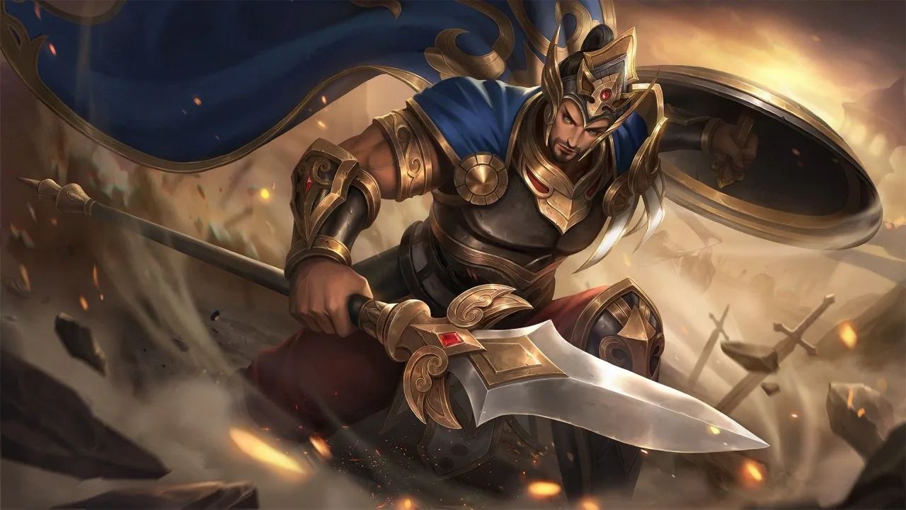

[Скины Минситтара](https://boostmlbb.ru/skins/minsitthar.html)

[Скины](https://boostmlbb.ru/skins/)/[Минситтар](https://boostmlbb.ru/skins/minsitthar.html)/Позолоченный король

[Скин Минситтара](https://boostmlbb.ru/skins/minsitthar.html)

# Позолоченный король

Gilded King

Обычный CommonЭлитныйВ продаже

Как получить

Продаётся в магазине обликов за 599 алмазов.

Цена

599 алмазов

Вышел

1 марта 2018

## Что меняет облик

-   Новая внешность
-   Другой цвет эффектов
-   Анимация показа
-   Бонус к характеристикам

## Все скины Минситтара [5](https://boostmlbb.ru/skins/minsitthar.html)

[Символ доблестиОбычный · 2024](https://boostmlbb.ru/skins/minsitthar/symbol-of-valor.html)[Непобе­димое солнцеИзысканный · 2024](https://boostmlbb.ru/skins/minsitthar/sol-invictus.html)[Боевой левИсключительный · 2023](https://boostmlbb.ru/skins/minsitthar/war-lion.html)[Король войныОбычный · 2022](https://boostmlbb.ru/skins/minsitthar/king-of-war.html)[Позоло­ченный корольОбычный · 2018](https://boostmlbb.ru/skins/minsitthar/gilded-king.html)

## Серия «Элитный»

[Золотой османтусЧан'Э · 2026](https://boostmlbb.ru/skins/change/golden-osmanthus.html)[Король-воена­чальникМартис · 2025](https://boostmlbb.ru/skins/martis/warlord-king.html)[Кадет открытого моряКимми · 2024](https://boostmlbb.ru/skins/kimmy/high-seas-cadet.html)[Зелёная копейщицаСильвана · 2024](https://boostmlbb.ru/skins/silvanna/verdant-lancer.html)[Мародёр Кровавое КопытоХилос · 2024](https://boostmlbb.ru/skins/hylos/bloodhoof-marauder.html)[Изящная бабочкаГвиневра · 2024](https://boostmlbb.ru/skins/guinevere/elegant-butterfly.html)[Маркиз клинковЛанселот · 2024](https://boostmlbb.ru/skins/lancelot/marques-of-blades.html)[Привал в пустошахЧип · 2024](https://boostmlbb.ru/skins/chip/badlands-hiatus.html)

**Сколько стоит буст на герое Минситтар?**Выберите текущий и желаемый ранг. Стоимость появится на сайте.

[Рассчитать цену](https://boostmlbb.ru/order.html?type=hero)

## Частые вопросы

Как получить скин «Позолоченный король» на Минситтара?

Продаётся в магазине обликов за 599 алмазов.

Когда вышел скин «Позолоченный король»?

1 марта 2018.

Какой класс у скина «Позолоченный король»?

Обычный (Common), серия «Элитный».
