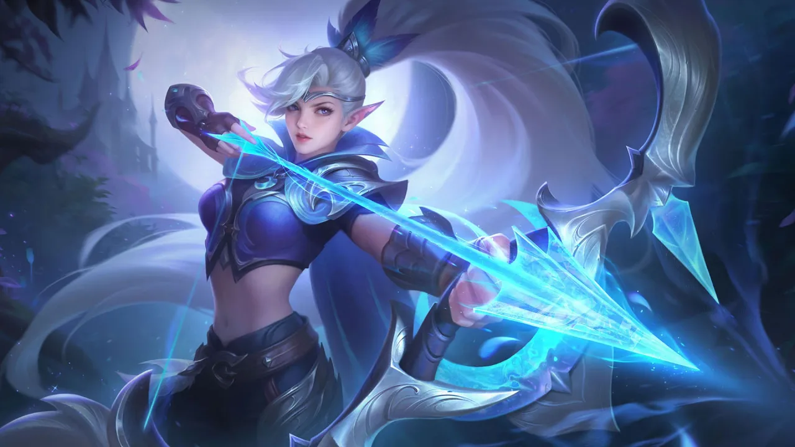

[Все скины](https://boostmlbb.ru/skins/)

[Скины](https://boostmlbb.ru/skins/)/Мия

# Скины Мии

Скинов

13

Можно купить

3

Последний

[Стрела весны](https://boostmlbb.ru/skins/miya/arrow-of-springs.html)2026

[Профиль героя→](https://boostmlbb.ru/heroes/miya.html)

## Все скины

ВсеВысшийГрандиозныйИзысканныйДелюксИсключительныйОбычный

[Стрела весныГрандиозный · 2026](https://boostmlbb.ru/skins/miya/arrow-of-springs.html)[Ночная охотницаИсключительный · 2025](https://boostmlbb.ru/skins/miya/nightowl-huntress.html)[Мия Atomic PopДелюкс · 2023](https://boostmlbb.ru/skins/miya/atomic-pop-miya.html)[Катали­затор гибелиИзысканный · 2022](https://boostmlbb.ru/skins/miya/doom-catalyst.html)[Лунная жрицаИсключительный · 2021](https://boostmlbb.ru/skins/miya/moon-priestess.html)[Лесная следопыткаОбычный · 2020](https://boostmlbb.ru/skins/miya/jungle-ranger.html)[СудзухимэИсключительный · 2018](https://boostmlbb.ru/skins/miya/suzuhime.html)[Сладкая фантазияИсключительный · 2018](https://boostmlbb.ru/skins/miya/sweet-fantasy.html)[ЧестьОбычный · 2017](https://boostmlbb.ru/skins/miya/honor.html)[Бабочка МоденыВысший · 2017](https://boostmlbb.ru/skins/miya/modena-butterfly.html)[Капитан ШиповИсключительный · 2017](https://boostmlbb.ru/skins/miya/captain-thorns.html)[Рож­дественский карнавалИзысканный · 2016](https://boostmlbb.ru/skins/miya/christmas-carnival.html)[Пылающий лукОбычный · 2016](https://boostmlbb.ru/skins/miya/burning-bow.html)

**Сколько стоит буст на герое Мия?**Выберите текущий и желаемый ранг. Стоимость появится на сайте.

[Рассчитать цену](https://boostmlbb.ru/order.html?type=hero)

## Частые вопросы

Сколько скинов у Мии?

13 скинов без стандартного облика. Последний — «Стрела весны» (Arrow of Springs), 20 февраля 2026.

Какие скины Мии можно купить сейчас?

«Честь» (599 алмазов), «Пылающий лук» (599 алмазов). Остальные облики ограниченные и возвращаются только в событиях.

Какой самый редкий скин Мии?

«Бабочка Модены» (Modena Butterfly), класс высший, серия «Легендарный». Обменивается на 200 магических кристаллов из Магического колеса.
