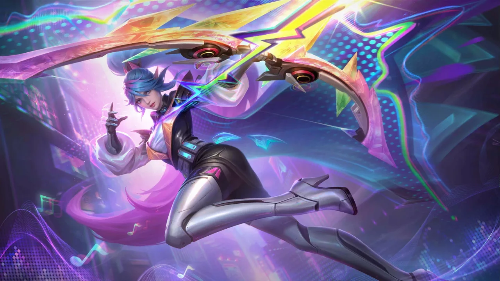
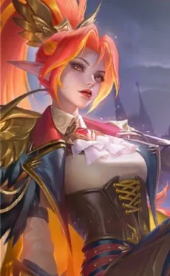
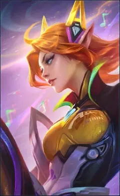

[Тир-лист](https://boostmlbb.ru/heroes/)[Предметы](https://boostmlbb.ru/items/)[Скины](https://boostmlbb.ru/skins/)[Новости и гайды](https://boostmlbb.ru/news/)

[Скины](https://boostmlbb.ru/skins/)/[Мия](https://boostmlbb.ru/skins/miya.html)/Мия Atomic Pop

[Скин Мии](https://boostmlbb.ru/skins/miya.html)

# Мия Atomic Pop

Atomic Pop Miya

Делюкс DeluxeAtomic PopОграниченный

Как получить

Цена на старте: 899 алмазов. Сейчас в магазине не продаётся, возвращается только в событиях.

Цена

899 алмазов

Вышел

2023 год

## Все скины Мии [13](https://boostmlbb.ru/skins/miya.html)

[Стрела весныГрандиозный · 2026](https://boostmlbb.ru/skins/miya/arrow-of-springs.html)[Ночная охотницаИсключительный · 2025](https://boostmlbb.ru/skins/miya/nightowl-huntress.html)[Мия Atomic PopДелюкс · 2023](https://boostmlbb.ru/skins/miya/atomic-pop-miya.html)[Катали­затор гибелиИзысканный · 2022](https://boostmlbb.ru/skins/miya/doom-catalyst.html)[Лунная жрицаИсключительный · 2021](https://boostmlbb.ru/skins/miya/moon-priestess.html)[Лесная следопыткаОбычный · 2020](https://boostmlbb.ru/skins/miya/jungle-ranger.html)[СудзухимэИсключительный · 2018](https://boostmlbb.ru/skins/miya/suzuhime.html)[Сладкая фантазияИсключительный · 2018](https://boostmlbb.ru/skins/miya/sweet-fantasy.html)[ЧестьОбычный · 2017](https://boostmlbb.ru/skins/miya/honor.html)[Бабочка МоденыВысший · 2017](https://boostmlbb.ru/skins/miya/modena-butterfly.html)[Капитан ШиповИсключительный · 2017](https://boostmlbb.ru/skins/miya/captain-thorns.html)[Рож­дественский карнавалИзысканный · 2016](https://boostmlbb.ru/skins/miya/christmas-carnival.html)[Пылающий лукОбычный · 2016](https://boostmlbb.ru/skins/miya/burning-bow.html)

## Серия «Atomic Pop»

[Эйдора Atomic PopЭйдора · 2023](https://boostmlbb.ru/skins/eudora/atomic-pop-eudora.html)

**Поднимем ранг на герое Мия**Цена считается в калькуляторе

[Рассчитать цену](https://boostmlbb.ru/order.html?type=hero)

## Частые вопросы

Как получить скин «Мия Atomic Pop» на Мию?

Цена на старте: 899 алмазов. Сейчас в магазине не продаётся, возвращается только в событиях.

Когда вышел скин «Мия Atomic Pop»?

2023 год.

Какой класс у скина «Мия Atomic Pop»?

Делюкс (Deluxe), серия «Atomic Pop».
