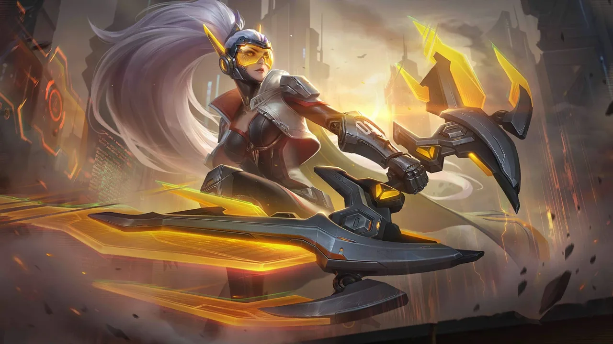

[Тир-лист](https://boostmlbb.ru/heroes/)[Предметы](https://boostmlbb.ru/items/)[Скины](https://boostmlbb.ru/skins/)[Новости и гайды](https://boostmlbb.ru/news/)

[Скины](https://boostmlbb.ru/skins/)/[Мия](https://boostmlbb.ru/skins/miya.html)/Катализатор гибели

[Скин Мии](https://boostmlbb.ru/skins/miya.html)

# Катализатор гибели

Doom Catalyst

Изысканный ExquisiteКоллекционныйОграниченный

Как получить

Главный приз розыгрыша в коллекционном событии, попытки покупаются за алмазы. Ограниченные облики иногда возвращаются в розыгрышах событий.

Вышел

сентябрь 2022

## Все скины Мии [13](https://boostmlbb.ru/skins/miya.html)

[Стрела весныГрандиозный · 2026](https://boostmlbb.ru/skins/miya/arrow-of-springs.html)[Ночная охотницаИсключительный · 2025](https://boostmlbb.ru/skins/miya/nightowl-huntress.html)[Мия Atomic PopДелюкс · 2023](https://boostmlbb.ru/skins/miya/atomic-pop-miya.html)[Катали­затор гибелиИзысканный · 2022](https://boostmlbb.ru/skins/miya/doom-catalyst.html)[Лунная жрицаИсключительный · 2021](https://boostmlbb.ru/skins/miya/moon-priestess.html)[Лесная следопыткаОбычный · 2020](https://boostmlbb.ru/skins/miya/jungle-ranger.html)[СудзухимэИсключительный · 2018](https://boostmlbb.ru/skins/miya/suzuhime.html)[Сладкая фантазияИсключительный · 2018](https://boostmlbb.ru/skins/miya/sweet-fantasy.html)[ЧестьОбычный · 2017](https://boostmlbb.ru/skins/miya/honor.html)[Бабочка МоденыВысший · 2017](https://boostmlbb.ru/skins/miya/modena-butterfly.html)[Капитан ШиповИсключительный · 2017](https://boostmlbb.ru/skins/miya/captain-thorns.html)[Рож­дественский карнавалИзысканный · 2016](https://boostmlbb.ru/skins/miya/christmas-carnival.html)[Пылающий лукОбычный · 2016](https://boostmlbb.ru/skins/miya/burning-bow.html)

## Серия «Коллекционный»

[ОчистительБруно · 2026](https://boostmlbb.ru/skins/bruno/the-purifier.html)[Небесный бунтарьСан · 2026](https://boostmlbb.ru/skins/sun/celestial-rebel.html)[Кайдзю глубинХелкарт · 2026](https://boostmlbb.ru/skins/helcurt/kaiju-of-the-deep.html)[Звёздный дозорныйКимми · 2026](https://boostmlbb.ru/skins/kimmy/starbound-sentry.html)[Монархиня грёзАлиса · 2026](https://boostmlbb.ru/skins/alice/dreaming-monarch.html)[Дрожь глубинГрок · 2026](https://boostmlbb.ru/skins/grock/tremor-of-the-deep.html)[Небесный генералТигрил · 2026](https://boostmlbb.ru/skins/tigreal/celestial-general.html)[Монарх, рождённый солнцемКсавьер · 2026](https://boostmlbb.ru/skins/xavier/sunborn-monarch.html)

**Поднимем ранг на герое Мия**Цена считается в калькуляторе

[Рассчитать цену](https://boostmlbb.ru/order.html?type=hero)

## Частые вопросы

Как получить скин «Катализатор гибели» на Мию?

Главный приз розыгрыша в коллекционном событии, попытки покупаются за алмазы. Ограниченные облики иногда возвращаются в розыгрышах событий.

Когда вышел скин «Катализатор гибели»?

Сентябрь 2022.

Какой класс у скина «Катализатор гибели»?

Изысканный (Exquisite), серия «Коллекционный».
