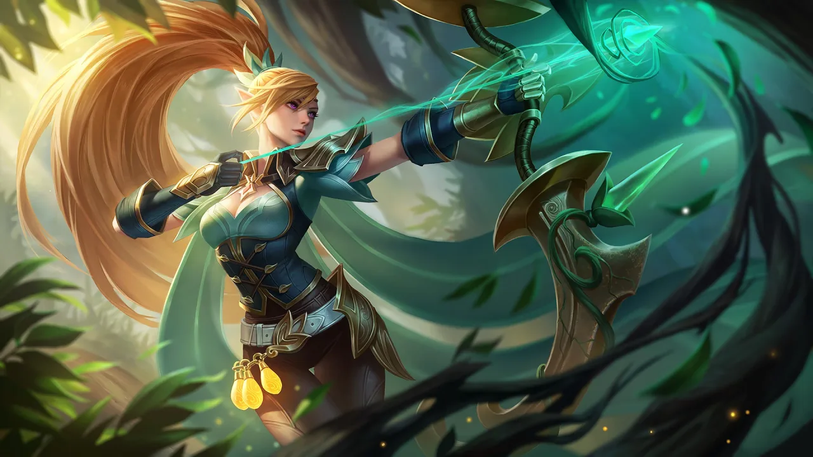

[Скины Мии](https://boostmlbb.ru/skins/miya.html)

[Скины](https://boostmlbb.ru/skins/)/[Мия](https://boostmlbb.ru/skins/miya.html)/Лесная следопытка

[Скин Мии](https://boostmlbb.ru/skins/miya.html)

# Лесная следопытка

Jungle Ranger

Обычный CommonОграниченный

Как получить

Цена на старте: 50 алмазов. Сейчас в магазине не продаётся, возвращается только в событиях. Подарок за первое пополнение в сезоне 18.

Цена

50 алмазов

Вышел

30 сентября 2020

## Все скины Мии [13](https://boostmlbb.ru/skins/miya.html)

[Стрела весныГрандиозный · 2026](https://boostmlbb.ru/skins/miya/arrow-of-springs.html)[Ночная охотницаИсключительный · 2025](https://boostmlbb.ru/skins/miya/nightowl-huntress.html)[Мия Atomic PopДелюкс · 2023](https://boostmlbb.ru/skins/miya/atomic-pop-miya.html)[Катали­затор гибелиИзысканный · 2022](https://boostmlbb.ru/skins/miya/doom-catalyst.html)[Лунная жрицаИсключительный · 2021](https://boostmlbb.ru/skins/miya/moon-priestess.html)[Лесная следопыткаОбычный · 2020](https://boostmlbb.ru/skins/miya/jungle-ranger.html)[СудзухимэИсключительный · 2018](https://boostmlbb.ru/skins/miya/suzuhime.html)[Сладкая фантазияИсключительный · 2018](https://boostmlbb.ru/skins/miya/sweet-fantasy.html)[ЧестьОбычный · 2017](https://boostmlbb.ru/skins/miya/honor.html)[Бабочка МоденыВысший · 2017](https://boostmlbb.ru/skins/miya/modena-butterfly.html)[Капитан ШиповИсключительный · 2017](https://boostmlbb.ru/skins/miya/captain-thorns.html)[Рож­дественский карнавалИзысканный · 2016](https://boostmlbb.ru/skins/miya/christmas-carnival.html)[Пылающий лукОбычный · 2016](https://boostmlbb.ru/skins/miya/burning-bow.html)

**Сколько стоит буст на герое Мия?**Выберите текущий и желаемый ранг. Стоимость появится на сайте.

[Рассчитать цену](https://boostmlbb.ru/order.html?type=hero)

## Частые вопросы

Как получить скин «Лесная следопытка» на Мию?

Цена на старте: 50 алмазов. Сейчас в магазине не продаётся, возвращается только в событиях. Подарок за первое пополнение в сезоне 18.

Когда вышел скин «Лесная следопытка»?

30 сентября 2020.

Какой класс у скина «Лесная следопытка»?

Обычный (Common).
