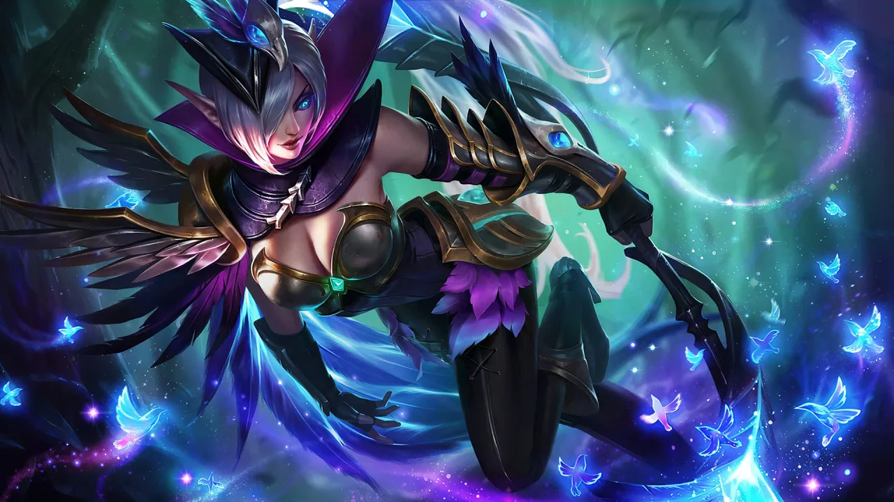

[Тир-лист](https://boostmlbb.ru/heroes/)[Предметы](https://boostmlbb.ru/items/)[Скины](https://boostmlbb.ru/skins/)[Новости и гайды](https://boostmlbb.ru/news/)

[Скины](https://boostmlbb.ru/skins/)/[Мия](https://boostmlbb.ru/skins/miya.html)/Бабочка Модены

[Скин Мии](https://boostmlbb.ru/skins/miya.html)

# Бабочка Модены

Modena Butterfly

Высший SupremeЛегендарныйВ продаже

Как получить

Обменивается на 200 магических кристаллов из Магического колеса.

Цена

200 магических кристаллов

Вышел

19 сентября 2017

## Все скины Мии [13](https://boostmlbb.ru/skins/miya.html)

[Стрела весныГрандиозный · 2026](https://boostmlbb.ru/skins/miya/arrow-of-springs.html)[Ночная охотницаИсключительный · 2025](https://boostmlbb.ru/skins/miya/nightowl-huntress.html)[Мия Atomic PopДелюкс · 2023](https://boostmlbb.ru/skins/miya/atomic-pop-miya.html)[Катали­затор гибелиИзысканный · 2022](https://boostmlbb.ru/skins/miya/doom-catalyst.html)[Лунная жрицаИсключительный · 2021](https://boostmlbb.ru/skins/miya/moon-priestess.html)[Лесная следопыткаОбычный · 2020](https://boostmlbb.ru/skins/miya/jungle-ranger.html)[СудзухимэИсключительный · 2018](https://boostmlbb.ru/skins/miya/suzuhime.html)[Сладкая фантазияИсключительный · 2018](https://boostmlbb.ru/skins/miya/sweet-fantasy.html)[ЧестьОбычный · 2017](https://boostmlbb.ru/skins/miya/honor.html)[Бабочка МоденыВысший · 2017](https://boostmlbb.ru/skins/miya/modena-butterfly.html)[Капитан ШиповИсключительный · 2017](https://boostmlbb.ru/skins/miya/captain-thorns.html)[Рож­дественский карнавалИзысканный · 2016](https://boostmlbb.ru/skins/miya/christmas-carnival.html)[Пылающий лукОбычный · 2016](https://boostmlbb.ru/skins/miya/burning-bow.html)

## Серия «Легендарный»

[Призрак розАльфа · 2025](https://boostmlbb.ru/skins/alpha/revenant-of-roses.html)[Повелитель мировДжонсон · 2025](https://boostmlbb.ru/skins/johnson/sovereign-of-realms.html)[Галакти­ческая победи­тельницаФрейя · 2024](https://boostmlbb.ru/skins/freya/galactic-vanquisher.html)[Божествен­ная богиняЛюнокс · 2023](https://boostmlbb.ru/skins/lunox/divine-goddess.html)[Король адаФранко · 2023](https://boostmlbb.ru/skins/franco/king-of-hell.html)[Псион будущегоГвиневра · 2022](https://boostmlbb.ru/skins/guinevere/psion-of-tomorrow.html)[Адское пламяВалир · 2022](https://boostmlbb.ru/skins/valir/infernal-blaze.html)[Косми­ческий отблескГоссен · 2022](https://boostmlbb.ru/skins/gusion/cosmic-gleam.html)

**Поднимем ранг на герое Мия**Цена считается в калькуляторе

[Рассчитать цену](https://boostmlbb.ru/order.html?type=hero)

## Частые вопросы

Как получить скин «Бабочка Модены» на Мию?

Обменивается на 200 магических кристаллов из Магического колеса.

Когда вышел скин «Бабочка Модены»?

19 сентября 2017.

Какой класс у скина «Бабочка Модены»?

Высший (Supreme), серия «Легендарный».
