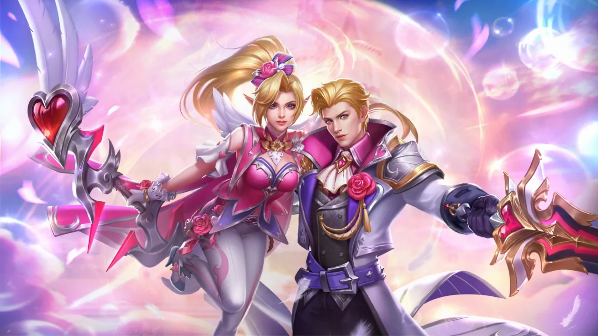
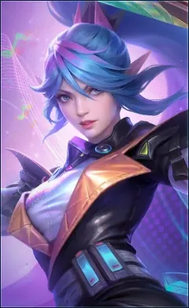
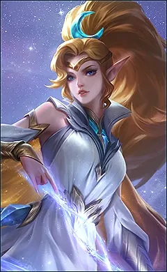

[Тир-лист](https://boostmlbb.ru/heroes/)[Предметы](https://boostmlbb.ru/items/)[Скины](https://boostmlbb.ru/skins/)[Новости и гайды](https://boostmlbb.ru/news/)

[Скины](https://boostmlbb.ru/skins/)/[Мия](https://boostmlbb.ru/skins/miya.html)/Сладкая фантазия

[Скин Мии](https://boostmlbb.ru/skins/miya.html)

# Сладкая фантазия

Sweet Fantasy

Исключительный ExceptionalДень святого ВалентинаОграниченный

Как получить

Цена на старте: 749 алмазов. Сейчас в магазине не продаётся, возвращается только в событиях.

Цена

749 алмазов

Вышел

11 февраля 2018

## Все скины Мии [13](https://boostmlbb.ru/skins/miya.html)

[Стрела весныГрандиозный · 2026](https://boostmlbb.ru/skins/miya/arrow-of-springs.html)[Ночная охотницаИсключительный · 2025](https://boostmlbb.ru/skins/miya/nightowl-huntress.html)[Мия Atomic PopДелюкс · 2023](https://boostmlbb.ru/skins/miya/atomic-pop-miya.html)[Катали­затор гибелиИзысканный · 2022](https://boostmlbb.ru/skins/miya/doom-catalyst.html)[Лунная жрицаИсключительный · 2021](https://boostmlbb.ru/skins/miya/moon-priestess.html)[Лесная следопыткаОбычный · 2020](https://boostmlbb.ru/skins/miya/jungle-ranger.html)[СудзухимэИсключительный · 2018](https://boostmlbb.ru/skins/miya/suzuhime.html)[Сладкая фантазияИсключительный · 2018](https://boostmlbb.ru/skins/miya/sweet-fantasy.html)[ЧестьОбычный · 2017](https://boostmlbb.ru/skins/miya/honor.html)[Бабочка МоденыВысший · 2017](https://boostmlbb.ru/skins/miya/modena-butterfly.html)[Капитан ШиповИсключительный · 2017](https://boostmlbb.ru/skins/miya/captain-thorns.html)[Рож­дественский карнавалИзысканный · 2016](https://boostmlbb.ru/skins/miya/christmas-carnival.html)[Пылающий лукОбычный · 2016](https://boostmlbb.ru/skins/miya/burning-bow.html)

## Серия «День святого Валентина»

[Пылающее сердцеКлауд · 2024](https://boostmlbb.ru/skins/claude/heart-aflame.html)[Манящая загадкаГрейнджер · 2024](https://boostmlbb.ru/skins/granger/alluring-enigma.html)[Манящая мистикаСильвана · 2024](https://boostmlbb.ru/skins/silvanna/alluring-mystique.html)[Джентльмен-ворХуфра · 2023](https://boostmlbb.ru/skins/khufra/gentleman-thief.html)[Парящее сердцеФанни · 2022](https://boostmlbb.ru/skins/fanny/heart-afloat.html)[Призрачная графиняКармилла · 2021](https://boostmlbb.ru/skins/carmilla/phantom-countess.html)[Призрачный графСесилион · 2021](https://boostmlbb.ru/skins/cecilion/phantom-count.html)[Леди-воровкаЭсмеральда · 2020](https://boostmlbb.ru/skins/esmeralda/lady-thief.html)

**Поднимем ранг на герое Мия**Цена считается в калькуляторе

[Рассчитать цену](https://boostmlbb.ru/order.html?type=hero)

## Частые вопросы

Как получить скин «Сладкая фантазия» на Мию?

Цена на старте: 749 алмазов. Сейчас в магазине не продаётся, возвращается только в событиях.

Когда вышел скин «Сладкая фантазия»?

11 февраля 2018.

Какой класс у скина «Сладкая фантазия»?

Исключительный (Exceptional), серия «День святого Валентина».
