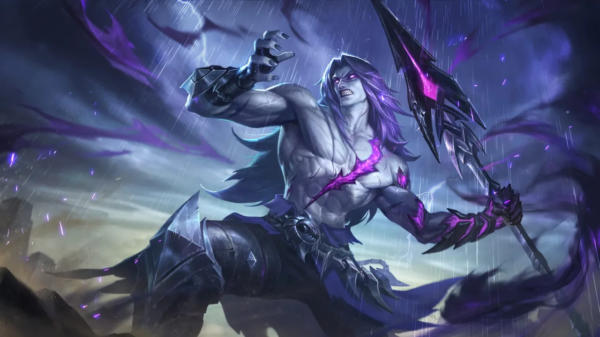

[Все скины](https://boostmlbb.ru/skins/)

[Скины](https://boostmlbb.ru/skins/)/Москов

# Скины Москова

Скинов

10

Можно купить

4

Последний

[Адский повелитель змиев](https://boostmlbb.ru/skins/moskov/infernal-wrymlord.html)2024

[Профиль героя→](https://boostmlbb.ru/heroes/moskov.html)

## Все скины

ВсеГрандиозныйИзысканныйДелюксИсключительныйОбычный

[Адский повелитель змиевГрандиозный · 2024](https://boostmlbb.ru/skins/moskov/infernal-wrymlord.html)[Воплощение рокаГрандиозный · 2023](https://boostmlbb.ru/skins/moskov/doom-incarnate.html)[Фиолетовое копьёИсключительный · 2023](https://boostmlbb.ru/skins/moskov/violet-spear.html)[Сумеречный драконИзысканный · 2019](https://boostmlbb.ru/skins/moskov/twilight-dragon.html)[Обезглав­ливательОбычный · 2018](https://boostmlbb.ru/skins/moskov/decapitator.html)[Чемпион по метанию копьяИсключительный · 2018](https://boostmlbb.ru/skins/moskov/javelin-champion.html)[ЯкшаОбычный · 2018](https://boostmlbb.ru/skins/moskov/yasha.html)[Кровавое копьёДелюкс · 2017](https://boostmlbb.ru/skins/moskov/blood-spear.html)[Командир Змеиный ГлазИсключительный · 2017](https://boostmlbb.ru/skins/moskov/snake-eye-commander.html)[Копьё костяного драконаОбычный · 2017](https://boostmlbb.ru/skins/moskov/spear-of-bone-dragon.html)

**Сколько стоит буст на герое Москов?**Выберите текущий и желаемый ранг. Стоимость появится на сайте.

[Рассчитать цену](https://boostmlbb.ru/order.html?type=hero)

## Частые вопросы

Сколько скинов у Москова?

10 скинов без стандартного облика. Последний — «Адский повелитель змиев» (Infernal Wrymlord), 6 апреля 2024.

Какие скины Москова можно купить сейчас?

«Обезглавливатель» (599 алмазов), «Чемпион по метанию копья» (749 алмазов), «Кровавое копьё» (899 алмазов), «Копьё костяного дракона» (269 алмазов). Остальные облики ограниченные и возвращаются только в событиях.

Какой самый редкий скин Москова?

«Адский повелитель змиев» (Infernal Wrymlord), класс грандиозный, серия «Матч всех звёзд 2024». Киберспортивный облик (Матч всех звёзд 2024): выходил в событии турнира. Ограниченные облики иногда возвращаются в розыгрышах событий.
