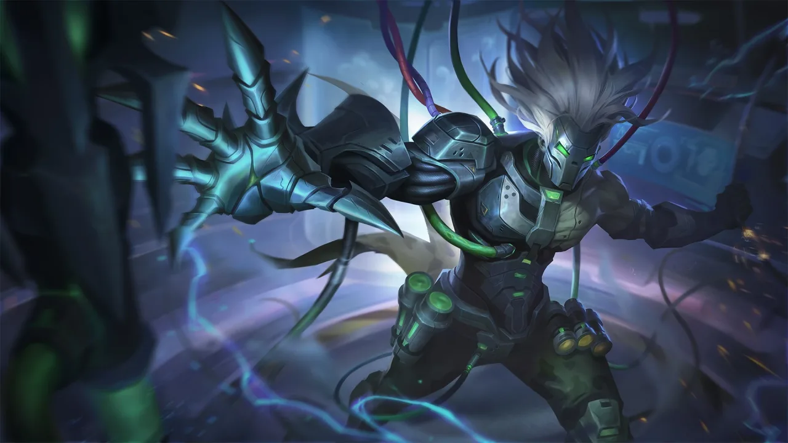
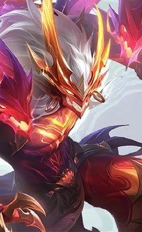
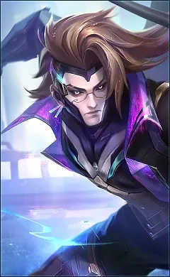

[Тир-лист](https://boostmlbb.ru/heroes/)[Предметы](https://boostmlbb.ru/items/)[Скины](https://boostmlbb.ru/skins/)[Новости и гайды](https://boostmlbb.ru/news/)

[Скины](https://boostmlbb.ru/skins/)/[Москов](https://boostmlbb.ru/skins/moskov.html)/Обезглавливатель

[Скин Москова](https://boostmlbb.ru/skins/moskov.html)

# Обезглавливатель

Decapitator

Обычный CommonЭлитныйВ продаже

Как получить

Продаётся в магазине обликов за 599 алмазов.

Цена

599 алмазов

Вышел

2018 год

## Что меняет облик

-   Новая внешность
-   Другой цвет эффектов
-   Анимация показа
-   Бонус к характеристикам

## Все скины Москова [10](https://boostmlbb.ru/skins/moskov.html)

[Адский повелитель змиевГрандиозный · 2024](https://boostmlbb.ru/skins/moskov/infernal-wrymlord.html)[Воплощение рокаГрандиозный · 2023](https://boostmlbb.ru/skins/moskov/doom-incarnate.html)[Фиолетовое копьёИсключительный · 2023](https://boostmlbb.ru/skins/moskov/violet-spear.html)[Сумеречный драконИзысканный · 2019](https://boostmlbb.ru/skins/moskov/twilight-dragon.html)[Обезглав­ливательОбычный · 2018](https://boostmlbb.ru/skins/moskov/decapitator.html)[Чемпион по метанию копьяИсключительный · 2018](https://boostmlbb.ru/skins/moskov/javelin-champion.html)[ЯкшаОбычный · 2018](https://boostmlbb.ru/skins/moskov/yasha.html)[Кровавое копьёДелюкс · 2017](https://boostmlbb.ru/skins/moskov/blood-spear.html)[Командир Змеиный ГлазИсключительный · 2017](https://boostmlbb.ru/skins/moskov/snake-eye-commander.html)[Копьё костяного драконаОбычный · 2017](https://boostmlbb.ru/skins/moskov/spear-of-bone-dragon.html)

## Серия «Элитный»

[Золотой османтусЧан'Э · 2026](https://boostmlbb.ru/skins/change/golden-osmanthus.html)[Король-воена­чальникМартис · 2025](https://boostmlbb.ru/skins/martis/warlord-king.html)[Кадет открытого моряКимми · 2024](https://boostmlbb.ru/skins/kimmy/high-seas-cadet.html)[Зелёная копейщицаСильвана · 2024](https://boostmlbb.ru/skins/silvanna/verdant-lancer.html)[Мародёр Кровавое КопытоХилос · 2024](https://boostmlbb.ru/skins/hylos/bloodhoof-marauder.html)[Изящная бабочкаГвиневра · 2024](https://boostmlbb.ru/skins/guinevere/elegant-butterfly.html)[Маркиз клинковЛанселот · 2024](https://boostmlbb.ru/skins/lancelot/marques-of-blades.html)[Привал в пустошахЧип · 2024](https://boostmlbb.ru/skins/chip/badlands-hiatus.html)

**Поднимем ранг на герое Москов**Цена считается в калькуляторе

[Рассчитать цену](https://boostmlbb.ru/order.html?type=hero)

## Частые вопросы

Как получить скин «Обезглавливатель» на Москова?

Продаётся в магазине обликов за 599 алмазов.

Когда вышел скин «Обезглавливатель»?

2018 год.

Какой класс у скина «Обезглавливатель»?

Обычный (Common), серия «Элитный».
