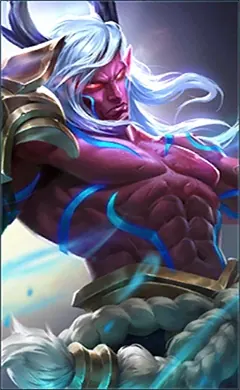

[Тир-лист](https://boostmlbb.ru/heroes/)[Предметы](https://boostmlbb.ru/items/)[Скины](https://boostmlbb.ru/skins/)[Новости и гайды](https://boostmlbb.ru/news/)

[Скины](https://boostmlbb.ru/skins/)/[Москов](https://boostmlbb.ru/skins/moskov.html)/Адский повелитель змиев

[Скин Москова](https://boostmlbb.ru/skins/moskov.html)

# Адский повелитель змиев

Infernal Wrymlord

Грандиозный GrandМатч всех звёзд 2024Ограниченный

Как получить

Киберспортивный облик (Матч всех звёзд 2024): выходил в событии турнира. Ограниченные облики иногда возвращаются в розыгрышах событий.

Вышел

6 апреля 2024

## Что меняет облик

-   Новая внешность
-   Новые эффекты навыков
-   Звуки навыков
-   Своя озвучка
-   Иконки навыков
-   Анимация показа
-   Сцена показа
-   Музыка показа
-   Анимация появления
-   Особые действия
-   Яркие спецэффекты
-   Бонус к характеристикам

## Все скины Москова [10](https://boostmlbb.ru/skins/moskov.html)

[Адский повелитель змиевГрандиозный · 2024](https://boostmlbb.ru/skins/moskov/infernal-wrymlord.html)[Воплощение рокаГрандиозный · 2023](https://boostmlbb.ru/skins/moskov/doom-incarnate.html)[Фиолетовое копьёИсключительный · 2023](https://boostmlbb.ru/skins/moskov/violet-spear.html)[Сумеречный драконИзысканный · 2019](https://boostmlbb.ru/skins/moskov/twilight-dragon.html)[Обезглав­ливательОбычный · 2018](https://boostmlbb.ru/skins/moskov/decapitator.html)[Чемпион по метанию копьяИсключительный · 2018](https://boostmlbb.ru/skins/moskov/javelin-champion.html)[ЯкшаОбычный · 2018](https://boostmlbb.ru/skins/moskov/yasha.html)[Кровавое копьёДелюкс · 2017](https://boostmlbb.ru/skins/moskov/blood-spear.html)[Командир Змеиный ГлазИсключительный · 2017](https://boostmlbb.ru/skins/moskov/snake-eye-commander.html)[Копьё костяного драконаОбычный · 2017](https://boostmlbb.ru/skins/moskov/spear-of-bone-dragon.html)

**Поднимем ранг на герое Москов**Цена считается в калькуляторе

[Рассчитать цену](https://boostmlbb.ru/order.html?type=hero)

## Частые вопросы

Как получить скин «Адский повелитель змиев» на Москова?

Киберспортивный облик (Матч всех звёзд 2024): выходил в событии турнира. Ограниченные облики иногда возвращаются в розыгрышах событий.

Когда вышел скин «Адский повелитель змиев»?

6 апреля 2024.

Какой класс у скина «Адский повелитель змиев»?

Грандиозный (Grand), серия «Матч всех звёзд 2024».
