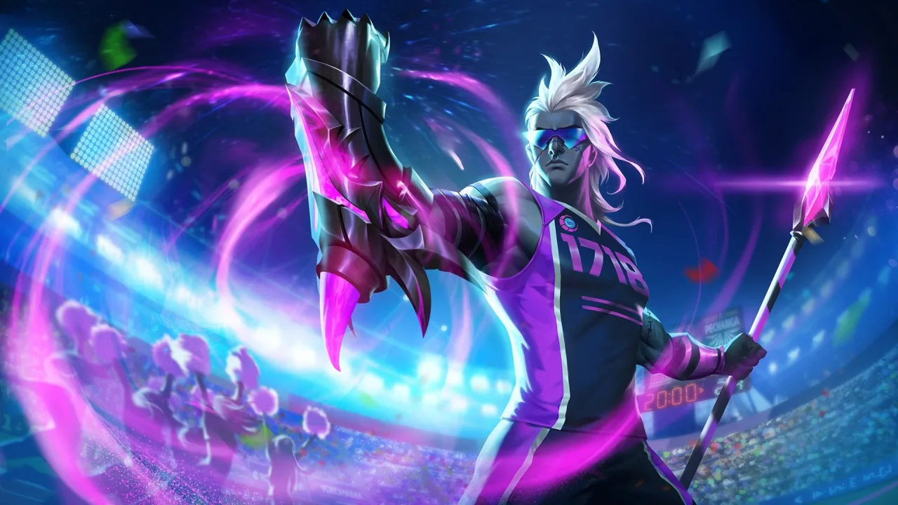

[Скины Москова](https://boostmlbb.ru/skins/moskov.html)

[Скины](https://boostmlbb.ru/skins/)/[Москов](https://boostmlbb.ru/skins/moskov.html)/Чемпион по метанию копья

[Скин Москова](https://boostmlbb.ru/skins/moskov.html)

# Чемпион по метанию копья

Javelin Champion

Исключительный ExceptionalОсобыйВ продаже

Как получить

Продаётся в магазине обликов за 749 алмазов.

Цена

749 алмазов

Вышел

2018 год

## Что меняет облик

-   Новая внешность
-   Новые эффекты навыков
-   Анимация показа
-   Бонус к характеристикам

## Перекраски

Тот же облик в других цветах. Перекраска открывается, только если у вас уже есть сам облик.

-   **Чемпион Азии по метанию копья** Asian Javelin ChampionНаграда «Звёздного участника» в августе 2019.

## Все скины Москова [10](https://boostmlbb.ru/skins/moskov.html)

[Адский повелитель змиевГрандиозный · 2024](https://boostmlbb.ru/skins/moskov/infernal-wrymlord.html)[Воплощение рокаГрандиозный · 2023](https://boostmlbb.ru/skins/moskov/doom-incarnate.html)[Фиолетовое копьёИсключительный · 2023](https://boostmlbb.ru/skins/moskov/violet-spear.html)[Сумеречный драконИзысканный · 2019](https://boostmlbb.ru/skins/moskov/twilight-dragon.html)[Обезглав­ливательОбычный · 2018](https://boostmlbb.ru/skins/moskov/decapitator.html)[Чемпион по метанию копьяИсключительный · 2018](https://boostmlbb.ru/skins/moskov/javelin-champion.html)[ЯкшаОбычный · 2018](https://boostmlbb.ru/skins/moskov/yasha.html)[Кровавое копьёДелюкс · 2017](https://boostmlbb.ru/skins/moskov/blood-spear.html)[Командир Змеиный ГлазИсключительный · 2017](https://boostmlbb.ru/skins/moskov/snake-eye-commander.html)[Копьё костяного драконаОбычный · 2017](https://boostmlbb.ru/skins/moskov/spear-of-bone-dragon.html)

## Серия «Особый»

[Тайный вердиктМатильда · 2026](https://boostmlbb.ru/skins/mathilda/arcane-verdict.html)[Вальс на ветруВэйл · 2026](https://boostmlbb.ru/skins/vale/windborne-waltz.html)[Капитан потерянныхФранко · 2026](https://boostmlbb.ru/skins/franco/captain-of-the-lost.html)[ВолнорезЛи Сун-Син · 2025](https://boostmlbb.ru/skins/yi-sun-shin/wavebreaker.html)[Стальные рукиБаданг · 2025](https://boostmlbb.ru/skins/badang/steel-arms.html)[Леди с зонтикомКагура · 2025](https://boostmlbb.ru/skins/kagura/lady-parasol.html)[Ужас пучиныАлдос · 2025](https://boostmlbb.ru/skins/aldous/fathom-terror.html)[Труппа лунного светаЧан'Э · 2025](https://boostmlbb.ru/skins/change/moonglow-troupe.html)

**Сколько стоит буст на герое Москов?**Выберите текущий и желаемый ранг. Стоимость появится на сайте.

[Рассчитать цену](https://boostmlbb.ru/order.html?type=hero)

## Частые вопросы

Как получить скин «Чемпион по метанию копья» на Москова?

Продаётся в магазине обликов за 749 алмазов.

Когда вышел скин «Чемпион по метанию копья»?

2018 год.

Какой класс у скина «Чемпион по метанию копья»?

Исключительный (Exceptional), серия «Особый».
