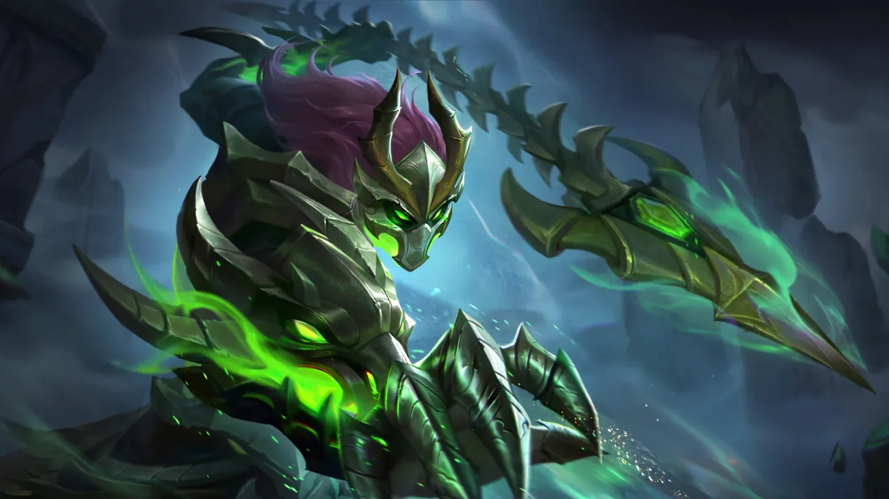

[Скины Москова](https://boostmlbb.ru/skins/moskov.html)

[Скины](https://boostmlbb.ru/skins/)/[Москов](https://boostmlbb.ru/skins/moskov.html)/Копьё костяного дракона

[Скин Москова](https://boostmlbb.ru/skins/moskov.html)

# Копьё костяного дракона

Spear of Bone Dragon

Обычный CommonВ продаже

Как получить

Продаётся в магазине обликов за 269 алмазов.

Цена

269 алмазов

Вышел

2017 год

## Что меняет облик

-   Бонус к характеристикам

## Все скины Москова [10](https://boostmlbb.ru/skins/moskov.html)

[Адский повелитель змиевГрандиозный · 2024](https://boostmlbb.ru/skins/moskov/infernal-wrymlord.html)[Воплощение рокаГрандиозный · 2023](https://boostmlbb.ru/skins/moskov/doom-incarnate.html)[Фиолетовое копьёИсключительный · 2023](https://boostmlbb.ru/skins/moskov/violet-spear.html)[Сумеречный драконИзысканный · 2019](https://boostmlbb.ru/skins/moskov/twilight-dragon.html)[Обезглав­ливательОбычный · 2018](https://boostmlbb.ru/skins/moskov/decapitator.html)[Чемпион по метанию копьяИсключительный · 2018](https://boostmlbb.ru/skins/moskov/javelin-champion.html)[ЯкшаОбычный · 2018](https://boostmlbb.ru/skins/moskov/yasha.html)[Кровавое копьёДелюкс · 2017](https://boostmlbb.ru/skins/moskov/blood-spear.html)[Командир Змеиный ГлазИсключительный · 2017](https://boostmlbb.ru/skins/moskov/snake-eye-commander.html)[Копьё костяного драконаОбычный · 2017](https://boostmlbb.ru/skins/moskov/spear-of-bone-dragon.html)

**Сколько стоит буст на герое Москов?**Выберите текущий и желаемый ранг. Стоимость появится на сайте.

[Рассчитать цену](https://boostmlbb.ru/order.html?type=hero)

## Частые вопросы

Как получить скин «Копьё костяного дракона» на Москова?

Продаётся в магазине обликов за 269 алмазов.

Когда вышел скин «Копьё костяного дракона»?

2017 год.

Какой класс у скина «Копьё костяного дракона»?

Обычный (Common).
