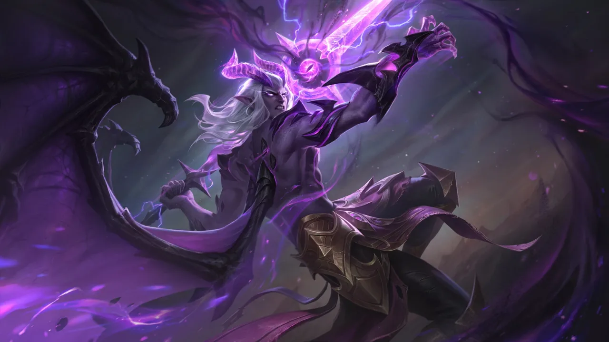

[Скины Москова](https://boostmlbb.ru/skins/moskov.html)

[Скины](https://boostmlbb.ru/skins/)/[Москов](https://boostmlbb.ru/skins/moskov.html)/Сумеречный дракон

[Скин Москова](https://boostmlbb.ru/skins/moskov.html)

# Сумеречный дракон

Twilight Dragon

Изысканный ExquisiteЯщик удачиОграниченный

Как получить

Выпадал из ящиков удачи в событиях. Ограниченные облики иногда возвращаются в розыгрышах событий.

Вышел

январь 2019

## Что меняет облик

-   Новая внешность
-   Новые эффекты навыков
-   Своя озвучка
-   Анимация показа
-   Сцена показа
-   Бонус к характеристикам

## Все скины Москова [10](https://boostmlbb.ru/skins/moskov.html)

[Адский повелитель змиевГрандиозный · 2024](https://boostmlbb.ru/skins/moskov/infernal-wrymlord.html)[Воплощение рокаГрандиозный · 2023](https://boostmlbb.ru/skins/moskov/doom-incarnate.html)[Фиолетовое копьёИсключительный · 2023](https://boostmlbb.ru/skins/moskov/violet-spear.html)[Сумеречный драконИзысканный · 2019](https://boostmlbb.ru/skins/moskov/twilight-dragon.html)[Обезглав­ливательОбычный · 2018](https://boostmlbb.ru/skins/moskov/decapitator.html)[Чемпион по метанию копьяИсключительный · 2018](https://boostmlbb.ru/skins/moskov/javelin-champion.html)[ЯкшаОбычный · 2018](https://boostmlbb.ru/skins/moskov/yasha.html)[Кровавое копьёДелюкс · 2017](https://boostmlbb.ru/skins/moskov/blood-spear.html)[Командир Змеиный ГлазИсключительный · 2017](https://boostmlbb.ru/skins/moskov/snake-eye-commander.html)[Копьё костяного драконаОбычный · 2017](https://boostmlbb.ru/skins/moskov/spear-of-bone-dragon.html)

## Серия «Ящик удачи»

[Леди-журавльГвиневра · 2025](https://boostmlbb.ru/skins/guinevere/lady-crane.html)[Серафим-бабочкаЛюнокс · 2025](https://boostmlbb.ru/skins/lunox/butterfly-seraphim.html)[МехадраконКлауд · 2025](https://boostmlbb.ru/skins/claude/mecha-dragon.html)[Лунная магияЧан'Э · 2020](https://boostmlbb.ru/skins/change/lunar-magic.html)[Громовая вспышкаСелена · 2020](https://boostmlbb.ru/skins/selena/thunder-flash.html)[РакшасаХанаби · 2020](https://boostmlbb.ru/skins/hanabi/rakshesha.html)[Повелитель видеоигрУранус · 2020](https://boostmlbb.ru/skins/uranus/video-game-dominator.html)[Бог войныМартис · 2020](https://boostmlbb.ru/skins/martis/god-of-war.html)

**Сколько стоит буст на герое Москов?**Выберите текущий и желаемый ранг. Стоимость появится на сайте.

[Рассчитать цену](https://boostmlbb.ru/order.html?type=hero)

## Частые вопросы

Как получить скин «Сумеречный дракон» на Москова?

Выпадал из ящиков удачи в событиях. Ограниченные облики иногда возвращаются в розыгрышах событий.

Когда вышел скин «Сумеречный дракон»?

Январь 2019.

Какой класс у скина «Сумеречный дракон»?

Изысканный (Exquisite), серия «Ящик удачи».
