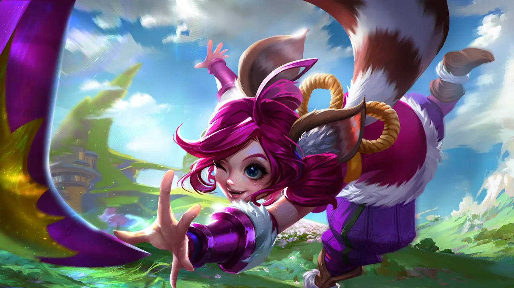

[Все скины](https://boostmlbb.ru/skins/)

[Скины](https://boostmlbb.ru/skins/)/Нана

# Скины Наны

Скинов

9

Можно купить

4

Последний

[Нана, заклина­тельница тумана](https://boostmlbb.ru/skins/nana/mistbender-nana.html)2023

[Профиль героя→](https://boostmlbb.ru/heroes/nana.html)

## Все скины

ВсеГрандиозныйИзысканныйДелюксИсключительныйОбычный

[Нана, заклина­тельница туманаГрандиозный · 2023](https://boostmlbb.ru/skins/nana/mistbender-nana.html)[Столкно­вение циклоновИсключительный · 2022](https://boostmlbb.ru/skins/nana/cyclone-clash.html)[Аква ПураИзысканный · 2021](https://boostmlbb.ru/skins/nana/aqua-pura.html)[Меха-малышкаДелюкс · 2020](https://boostmlbb.ru/skins/nana/mecha-baby.html)[Летнее платьеИсключительный · 2019](https://boostmlbb.ru/skins/nana/sundress.html)[Фея ветраИсключительный · 2018](https://boostmlbb.ru/skins/nana/wind-fairy.html)[Пижамная вечеринкаОбычный · 2017](https://boostmlbb.ru/skins/nana/slumber-party.html)[Вечеринка на кладбищеОбычный · 2016](https://boostmlbb.ru/skins/nana/graveyard-party.html)[Заводная горничнаяОбычный · 2016](https://boostmlbb.ru/skins/nana/clockwork-maid.html)

**Сколько стоит буст на герое Нана?**Выберите текущий и желаемый ранг. Стоимость появится на сайте.

[Рассчитать цену](https://boostmlbb.ru/order.html?type=hero)

## Частые вопросы

Сколько скинов у Наны?

9 скинов без стандартного облика. Последний — «Нана, заклинательница тумана» (Mistbender Nana), 9 декабря 2023.

Какие скины Наны можно купить сейчас?

«Меха-малышка» (899 алмазов), «Летнее платье» (749 алмазов), «Пижамная вечеринка» (599 алмазов), «Заводная горничная» (399 алмазов). Остальные облики ограниченные и возвращаются только в событиях.

Какой самый редкий скин Наны?

«Нана, заклинательница тумана» (Mistbender Nana), класс грандиозный, серия «Заклинатели тумана». Выходил в событии «Заклинатели тумана». Ограниченные облики иногда возвращаются в розыгрышах событий.
