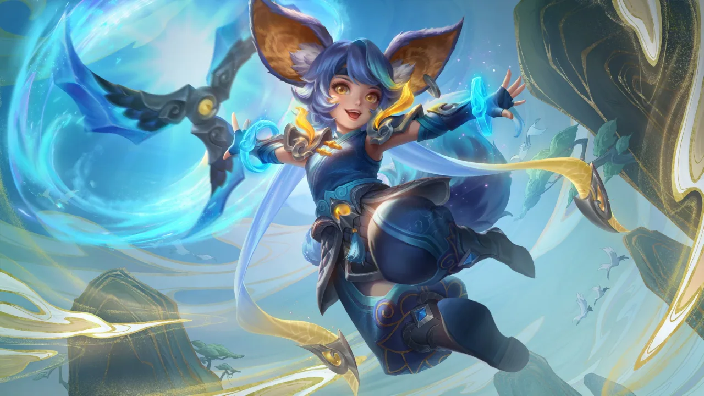

[Тир-лист](https://boostmlbb.ru/heroes/)[Предметы](https://boostmlbb.ru/items/)[Скины](https://boostmlbb.ru/skins/)[Новости и гайды](https://boostmlbb.ru/news/)

[Скины](https://boostmlbb.ru/skins/)/[Нана](https://boostmlbb.ru/skins/nana.html)/Аква Пура

[Скин Наны](https://boostmlbb.ru/skins/nana.html)

# Аква Пура

Aqua Pura

Изысканный ExquisiteКоллекционныйОграниченный

Как получить

Главный приз розыгрыша в коллекционном событии, попытки покупаются за алмазы. Ограниченные облики иногда возвращаются в розыгрышах событий.

Вышел

декабрь 2021

## Что меняет облик

-   Новая внешность
-   Новые эффекты навыков
-   Звуки навыков
-   Своя озвучка
-   Анимация показа
-   Сцена показа
-   Бонус к характеристикам

## Все скины Наны [9](https://boostmlbb.ru/skins/nana.html)

[Нана, заклина­тельница туманаГрандиозный · 2023](https://boostmlbb.ru/skins/nana/mistbender-nana.html)[Столкно­вение циклоновИсключительный · 2022](https://boostmlbb.ru/skins/nana/cyclone-clash.html)[Аква ПураИзысканный · 2021](https://boostmlbb.ru/skins/nana/aqua-pura.html)[Меха-малышкаДелюкс · 2020](https://boostmlbb.ru/skins/nana/mecha-baby.html)[Летнее платьеИсключительный · 2019](https://boostmlbb.ru/skins/nana/sundress.html)[Фея ветраИсключительный · 2018](https://boostmlbb.ru/skins/nana/wind-fairy.html)[Пижамная вечеринкаОбычный · 2017](https://boostmlbb.ru/skins/nana/slumber-party.html)[Вечеринка на кладбищеОбычный · 2016](https://boostmlbb.ru/skins/nana/graveyard-party.html)[Заводная горничнаяОбычный · 2016](https://boostmlbb.ru/skins/nana/clockwork-maid.html)

## Серия «Коллекционный»

[ОчистительБруно · 2026](https://boostmlbb.ru/skins/bruno/the-purifier.html)[Небесный бунтарьСан · 2026](https://boostmlbb.ru/skins/sun/celestial-rebel.html)[Кайдзю глубинХелкарт · 2026](https://boostmlbb.ru/skins/helcurt/kaiju-of-the-deep.html)[Звёздный дозорныйКимми · 2026](https://boostmlbb.ru/skins/kimmy/starbound-sentry.html)[Монархиня грёзАлиса · 2026](https://boostmlbb.ru/skins/alice/dreaming-monarch.html)[Дрожь глубинГрок · 2026](https://boostmlbb.ru/skins/grock/tremor-of-the-deep.html)[Небесный генералТигрил · 2026](https://boostmlbb.ru/skins/tigreal/celestial-general.html)[Монарх, рождённый солнцемКсавьер · 2026](https://boostmlbb.ru/skins/xavier/sunborn-monarch.html)

**Поднимем ранг на герое Нана**Цена считается в калькуляторе

[Рассчитать цену](https://boostmlbb.ru/order.html?type=hero)

## Частые вопросы

Как получить скин «Аква Пура» на Нану?

Главный приз розыгрыша в коллекционном событии, попытки покупаются за алмазы. Ограниченные облики иногда возвращаются в розыгрышах событий.

Когда вышел скин «Аква Пура»?

Декабрь 2021.

Какой класс у скина «Аква Пура»?

Изысканный (Exquisite), серия «Коллекционный».
