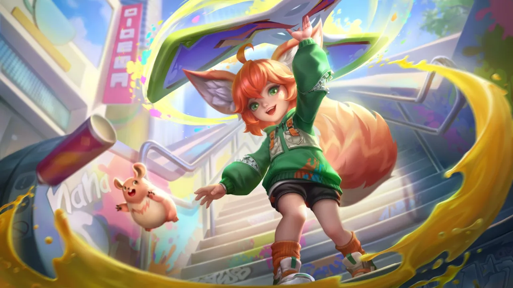
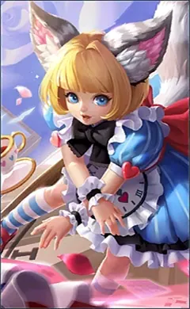

[Скины Наны](https://boostmlbb.ru/skins/nana.html)

[Скины](https://boostmlbb.ru/skins/)/[Нана](https://boostmlbb.ru/skins/nana.html)/Столкновение циклонов

[Скин Наны](https://boostmlbb.ru/skins/nana.html)

# Столкновение циклонов

Cyclone Clash

Исключительный ExceptionalЗвёздный участникОграниченный

Как получить

Награда «Звёздного участника» в июле 2022.

Вышел

1 июля 2022

## Что меняет облик

-   Новая внешность
-   Новые эффекты навыков
-   Анимация показа
-   Сцена показа
-   Бонус к характеристикам

## Все скины Наны [9](https://boostmlbb.ru/skins/nana.html)

[Нана, заклина­тельница туманаГрандиозный · 2023](https://boostmlbb.ru/skins/nana/mistbender-nana.html)[Столкно­вение циклоновИсключительный · 2022](https://boostmlbb.ru/skins/nana/cyclone-clash.html)[Аква ПураИзысканный · 2021](https://boostmlbb.ru/skins/nana/aqua-pura.html)[Меха-малышкаДелюкс · 2020](https://boostmlbb.ru/skins/nana/mecha-baby.html)[Летнее платьеИсключительный · 2019](https://boostmlbb.ru/skins/nana/sundress.html)[Фея ветраИсключительный · 2018](https://boostmlbb.ru/skins/nana/wind-fairy.html)[Пижамная вечеринкаОбычный · 2017](https://boostmlbb.ru/skins/nana/slumber-party.html)[Вечеринка на кладбищеОбычный · 2016](https://boostmlbb.ru/skins/nana/graveyard-party.html)[Заводная горничнаяОбычный · 2016](https://boostmlbb.ru/skins/nana/clockwork-maid.html)

## Серия «Звёздный участник»

[Морячка, рождённая приливомКалеа · 2026](https://boostmlbb.ru/skins/kalea/tideborn-sailor.html)[Тень кицунэХаябуса · 2026](https://boostmlbb.ru/skins/hayabusa/kitsune-s-shadow.html)[Клыки резниХанзо · 2026](https://boostmlbb.ru/skins/hanzo/fangs-of-slaughter.html)[Тлеющая крепостьБелерик · 2026](https://boostmlbb.ru/skins/belerick/smouldering-fortress.html)[Магитех­нический призракОбсидия · 2026](https://boostmlbb.ru/skins/obsidia/magitech-wraith.html)[Элизийское сияниеЦзэтянь · 2026](https://boostmlbb.ru/skins/zetian/elysian-luminance.html)[Батальон стражейХильда · 2026](https://boostmlbb.ru/skins/hilda/guardian-battalion.html)[Мечта­тельный коиХарли · 2026](https://boostmlbb.ru/skins/harley/dreaming-koi.html)

**Сколько стоит буст на герое Нана?**Выберите текущий и желаемый ранг. Стоимость появится на сайте.

[Рассчитать цену](https://boostmlbb.ru/order.html?type=hero)

## Частые вопросы

Как получить скин «Столкновение циклонов» на Нану?

Награда «Звёздного участника» в июле 2022.

Когда вышел скин «Столкновение циклонов»?

1 июля 2022.

Какой класс у скина «Столкновение циклонов»?

Исключительный (Exceptional), серия «Звёздный участник».
