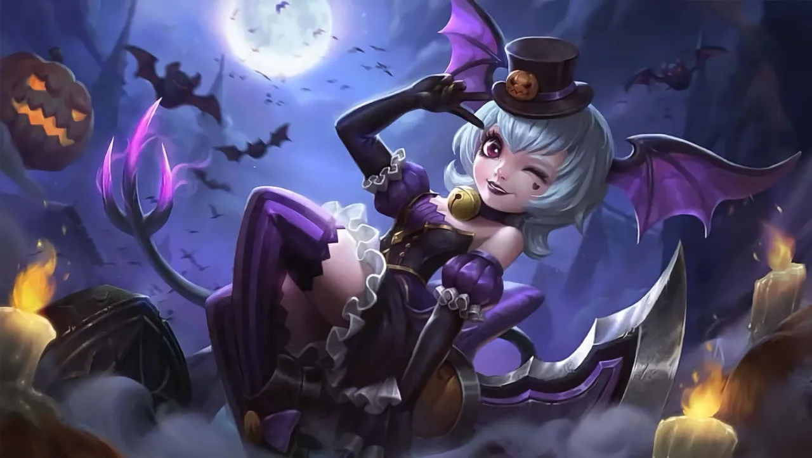

[Скины Наны](https://boostmlbb.ru/skins/nana.html)

[Скины](https://boostmlbb.ru/skins/)/[Нана](https://boostmlbb.ru/skins/nana.html)/Вечеринка на кладбище

[Скин Наны](https://boostmlbb.ru/skins/nana.html)

# Вечеринка на кладбище

Graveyard Party

Обычный CommonСезон 1Ограниченный

Как получить

Награда за рейтинговый сезон 1.

Вышел

2016 год

## Что меняет облик

-   Новая внешность
-   Бонус к характеристикам

## Все скины Наны [9](https://boostmlbb.ru/skins/nana.html)

[Нана, заклина­тельница туманаГрандиозный · 2023](https://boostmlbb.ru/skins/nana/mistbender-nana.html)[Столкно­вение циклоновИсключительный · 2022](https://boostmlbb.ru/skins/nana/cyclone-clash.html)[Аква ПураИзысканный · 2021](https://boostmlbb.ru/skins/nana/aqua-pura.html)[Меха-малышкаДелюкс · 2020](https://boostmlbb.ru/skins/nana/mecha-baby.html)[Летнее платьеИсключительный · 2019](https://boostmlbb.ru/skins/nana/sundress.html)[Фея ветраИсключительный · 2018](https://boostmlbb.ru/skins/nana/wind-fairy.html)[Пижамная вечеринкаОбычный · 2017](https://boostmlbb.ru/skins/nana/slumber-party.html)[Вечеринка на кладбищеОбычный · 2016](https://boostmlbb.ru/skins/nana/graveyard-party.html)[Заводная горничнаяОбычный · 2016](https://boostmlbb.ru/skins/nana/clockwork-maid.html)

**Сколько стоит буст на герое Нана?**Выберите текущий и желаемый ранг. Стоимость появится на сайте.

[Рассчитать цену](https://boostmlbb.ru/order.html?type=hero)

## Частые вопросы

Как получить скин «Вечеринка на кладбище» на Нану?

Награда за рейтинговый сезон 1.

Когда вышел скин «Вечеринка на кладбище»?

2016 год.

Какой класс у скина «Вечеринка на кладбище»?

Обычный (Common), серия «Сезон 1».
