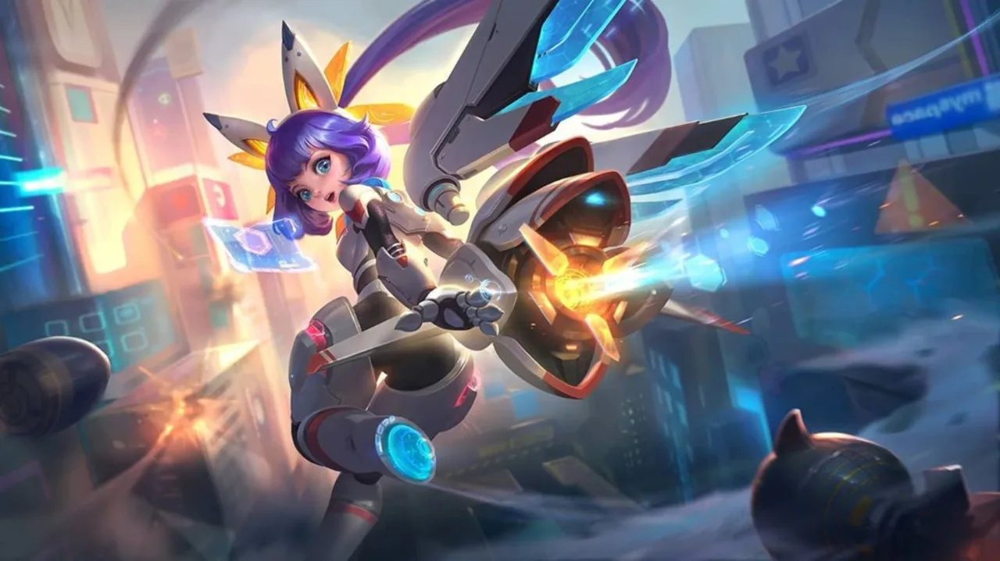

[Тир-лист](https://boostmlbb.ru/heroes/)[Предметы](https://boostmlbb.ru/items/)[Скины](https://boostmlbb.ru/skins/)[Новости и гайды](https://boostmlbb.ru/news/)

[Скины](https://boostmlbb.ru/skins/)/[Нана](https://boostmlbb.ru/skins/nana.html)/Меха-малышка

[Скин Наны](https://boostmlbb.ru/skins/nana.html)

# Меха-малышка

Mecha Baby

Делюкс DeluxeЭпическийВ продаже

Как получить

Продаётся в магазине обликов за 899 алмазов.

Цена

899 алмазов

Вышел

2020 год

## Что меняет облик

-   Новая внешность
-   Новые эффекты навыков
-   Анимация показа
-   Сцена показа
-   Бонус к характеристикам

## Все скины Наны [9](https://boostmlbb.ru/skins/nana.html)

[Нана, заклина­тельница туманаГрандиозный · 2023](https://boostmlbb.ru/skins/nana/mistbender-nana.html)[Столкно­вение циклоновИсключительный · 2022](https://boostmlbb.ru/skins/nana/cyclone-clash.html)[Аква ПураИзысканный · 2021](https://boostmlbb.ru/skins/nana/aqua-pura.html)[Меха-малышкаДелюкс · 2020](https://boostmlbb.ru/skins/nana/mecha-baby.html)[Летнее платьеИсключительный · 2019](https://boostmlbb.ru/skins/nana/sundress.html)[Фея ветраИсключительный · 2018](https://boostmlbb.ru/skins/nana/wind-fairy.html)[Пижамная вечеринкаОбычный · 2017](https://boostmlbb.ru/skins/nana/slumber-party.html)[Вечеринка на кладбищеОбычный · 2016](https://boostmlbb.ru/skins/nana/graveyard-party.html)[Заводная горничнаяОбычный · 2016](https://boostmlbb.ru/skins/nana/clockwork-maid.html)

## Серия «Эпический»

[Надзи­ратель преис­поднейМинотавр · 2026](https://boostmlbb.ru/skins/minotaur/nether-overseer.html)[Затонувшее проклятиеАтлас · 2026](https://boostmlbb.ru/skins/atlas/sunken-curse.html)[Вечная клятваВексана · 2026](https://boostmlbb.ru/skins/vexana/eternal-vow.html)[Проклятый свитокХуфра · 2025](https://boostmlbb.ru/skins/khufra/cursed-scroll.html)[Охотница за душамиНаталья · 2025](https://boostmlbb.ru/skins/natalia/soul-huntress.html)[Граф кошмаровЛеоморд · 2025](https://boostmlbb.ru/skins/leomord/nightmare-count.html)[Вершитель звёздБелерик · 2025](https://boostmlbb.ru/skins/belerick/arbiter-of-stars.html)[Хранитель ветровВэйл · 2025](https://boostmlbb.ru/skins/vale/keeper-of-the-winds.html)

**Поднимем ранг на герое Нана**Цена считается в калькуляторе

[Рассчитать цену](https://boostmlbb.ru/order.html?type=hero)

## Частые вопросы

Как получить скин «Меха-малышка» на Нану?

Продаётся в магазине обликов за 899 алмазов.

Когда вышел скин «Меха-малышка»?

2020 год.

Какой класс у скина «Меха-малышка»?

Делюкс (Deluxe), серия «Эпический».
