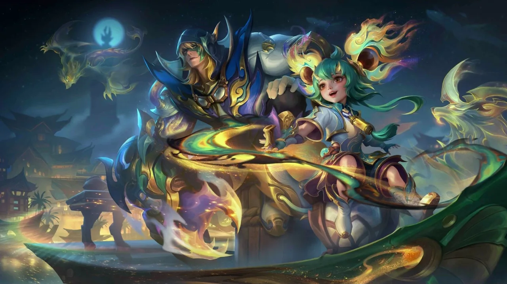

[Скины Наны](https://boostmlbb.ru/skins/nana.html)

[Скины](https://boostmlbb.ru/skins/)/[Нана](https://boostmlbb.ru/skins/nana.html)/Нана, заклинательница тумана

[Скин Наны](https://boostmlbb.ru/skins/nana.html)

# Нана, заклинательница тумана

Mistbender Nana

Грандиозный GrandЗаклинатели туманаОграниченный

Как получить

Выходил в событии «Заклинатели тумана». Ограниченные облики иногда возвращаются в розыгрышах событий.

Вышел

9 декабря 2023

## Что меняет облик

-   Новая внешность
-   Новые эффекты навыков
-   Звуки навыков
-   Своя озвучка
-   Анимация показа
-   Сцена показа
-   Музыка показа
-   Анимация появления
-   Особые действия
-   Бонус к характеристикам

## Все скины Наны [9](https://boostmlbb.ru/skins/nana.html)

[Нана, заклина­тельница туманаГрандиозный · 2023](https://boostmlbb.ru/skins/nana/mistbender-nana.html)[Столкно­вение циклоновИсключительный · 2022](https://boostmlbb.ru/skins/nana/cyclone-clash.html)[Аква ПураИзысканный · 2021](https://boostmlbb.ru/skins/nana/aqua-pura.html)[Меха-малышкаДелюкс · 2020](https://boostmlbb.ru/skins/nana/mecha-baby.html)[Летнее платьеИсключительный · 2019](https://boostmlbb.ru/skins/nana/sundress.html)[Фея ветраИсключительный · 2018](https://boostmlbb.ru/skins/nana/wind-fairy.html)[Пижамная вечеринкаОбычный · 2017](https://boostmlbb.ru/skins/nana/slumber-party.html)[Вечеринка на кладбищеОбычный · 2016](https://boostmlbb.ru/skins/nana/graveyard-party.html)[Заводная горничнаяОбычный · 2016](https://boostmlbb.ru/skins/nana/clockwork-maid.html)

## Серия «Заклинатели тумана»

[Алдос, закли­натель туманаАлдос · 2023](https://boostmlbb.ru/skins/aldous/mistbender-aldous.html)

**Сколько стоит буст на герое Нана?**Выберите текущий и желаемый ранг. Стоимость появится на сайте.

[Рассчитать цену](https://boostmlbb.ru/order.html?type=hero)

## Частые вопросы

Как получить скин «Нана, заклинательница тумана» на Нану?

Выходил в событии «Заклинатели тумана». Ограниченные облики иногда возвращаются в розыгрышах событий.

Когда вышел скин «Нана, заклинательница тумана»?

9 декабря 2023.

Какой класс у скина «Нана, заклинательница тумана»?

Грандиозный (Grand), серия «Заклинатели тумана».
