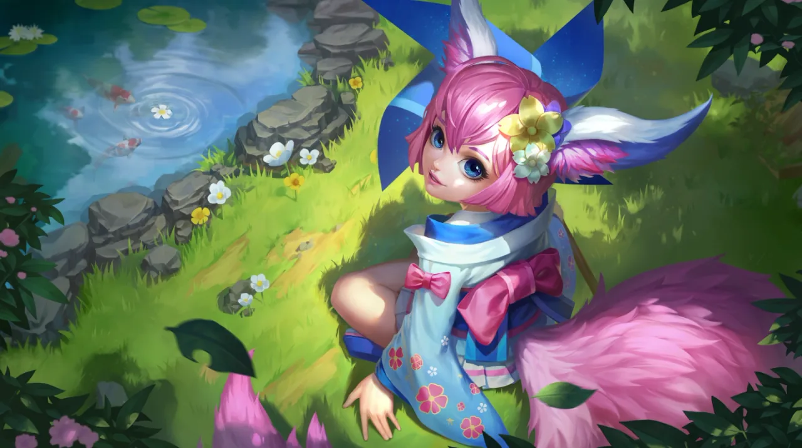

[Скины Наны](https://boostmlbb.ru/skins/nana.html)

[Скины](https://boostmlbb.ru/skins/)/[Нана](https://boostmlbb.ru/skins/nana.html)/Фея ветра

[Скин Наны](https://boostmlbb.ru/skins/nana.html)

# Фея ветра

Wind Fairy

Исключительный ExceptionalMPLОграниченный

Как получить

Киберспортивный облик (MPL): выходил в событии турнира. Ограниченные облики иногда возвращаются в розыгрышах событий.

Вышел

2018 год

## Что меняет облик

-   Новая внешность
-   Новые эффекты навыков
-   Анимация показа
-   Бонус к характеристикам

## Все скины Наны [9](https://boostmlbb.ru/skins/nana.html)

[Нана, заклина­тельница туманаГрандиозный · 2023](https://boostmlbb.ru/skins/nana/mistbender-nana.html)[Столкно­вение циклоновИсключительный · 2022](https://boostmlbb.ru/skins/nana/cyclone-clash.html)[Аква ПураИзысканный · 2021](https://boostmlbb.ru/skins/nana/aqua-pura.html)[Меха-малышкаДелюкс · 2020](https://boostmlbb.ru/skins/nana/mecha-baby.html)[Летнее платьеИсключительный · 2019](https://boostmlbb.ru/skins/nana/sundress.html)[Фея ветраИсключительный · 2018](https://boostmlbb.ru/skins/nana/wind-fairy.html)[Пижамная вечеринкаОбычный · 2017](https://boostmlbb.ru/skins/nana/slumber-party.html)[Вечеринка на кладбищеОбычный · 2016](https://boostmlbb.ru/skins/nana/graveyard-party.html)[Заводная горничнаяОбычный · 2016](https://boostmlbb.ru/skins/nana/clockwork-maid.html)

## Серия «MPL»

[Квантовый коммандосБаданг · 2026](https://boostmlbb.ru/skins/badang/quantum-commando.html)[Квантовая полярностьЛюнокс · 2025](https://boostmlbb.ru/skins/lunox/quantum-polarity.html)[Призмати­ческая часоваяЭдит · 2025](https://boostmlbb.ru/skins/edith/prismatic-sentinel.html)[Квантовый авангардФранко · 2024](https://boostmlbb.ru/skins/franco/quantum-vanguard.html)[Квантовое лезвиеБенедетта · 2024](https://boostmlbb.ru/skins/benedetta/quantum-edge.html)[ГидромантКадита · 2023](https://boostmlbb.ru/skins/kadita/hydromancer.html)[Кибер-рейнджерКусака · 2023](https://boostmlbb.ru/skins/jawhead/cyber-ranger.html)[Квантовая хваткаБроуди · 2023](https://boostmlbb.ru/skins/brody/quantum-grip.html)

**Сколько стоит буст на герое Нана?**Выберите текущий и желаемый ранг. Стоимость появится на сайте.

[Рассчитать цену](https://boostmlbb.ru/order.html?type=hero)

## Частые вопросы

Как получить скин «Фея ветра» на Нану?

Киберспортивный облик (MPL): выходил в событии турнира. Ограниченные облики иногда возвращаются в розыгрышах событий.

Когда вышел скин «Фея ветра»?

2018 год.

Какой класс у скина «Фея ветра»?

Исключительный (Exceptional), серия «MPL».
