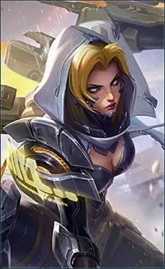

[Все скины](https://boostmlbb.ru/skins/)

[Скины](https://boostmlbb.ru/skins/)/Наталья

# Скины Натальи

Скинов

8

Можно купить

4

Последний

[Охотница за душами](https://boostmlbb.ru/skins/natalia/soul-huntress.html)2025

[Профиль героя→](https://boostmlbb.ru/heroes/natalia.html)

## Все скины

ВсеИзысканныйДелюксИсключительныйОбычный

[Охотница за душамиДелюкс · 2025](https://boostmlbb.ru/skins/natalia/soul-huntress.html)[Образцовая вои­тельницаИзысканный · 2024](https://boostmlbb.ru/skins/natalia/warrioress-paragon.html)[Кибер-призракИсключительный · 2020](https://boostmlbb.ru/skins/natalia/cyber-spectre.html)[Мрачная души­тельницаИсключительный · 2020](https://boostmlbb.ru/skins/natalia/grim-strangler.html)[Полуночный воронИсключительный · 2018](https://boostmlbb.ru/skins/natalia/midnight-raven.html)[Смерто­носная мамбаОбычный · 2018](https://boostmlbb.ru/skins/natalia/deadly-mamba.html)[Призрачная танцовщицаИсключительный · 2017](https://boostmlbb.ru/skins/natalia/phantom-dancer.html)[Стеклянный клинокОбычный · 2016](https://boostmlbb.ru/skins/natalia/glass-blade.html)

**Сколько стоит буст на герое Наталья?**Выберите текущий и желаемый ранг. Стоимость появится на сайте.

[Рассчитать цену](https://boostmlbb.ru/order.html?type=hero)

## Частые вопросы

Сколько скинов у Натальи?

8 скинов без стандартного облика. Последний — «Охотница за душами» (Soul Huntress), 17 августа 2025.

Какие скины Натальи можно купить сейчас?

«Охотница за душами» (899 алмазов), «Кибер-призрак» (749 алмазов), «Полуночный ворон» (749 алмазов), «Стеклянный клинок» (269 алмазов). Остальные облики ограниченные и возвращаются только в событиях.

Какой самый редкий скин Натальи?

«Образцовая воительница» (Warrioress Paragon), класс изысканный, серия «Коллекционный». Главный приз розыгрыша в коллекционном событии, попытки покупаются за алмазы. Ограниченные облики иногда возвращаются в розыгрышах событий.
