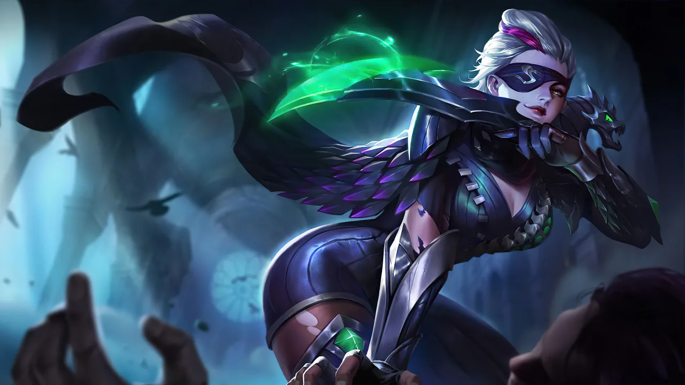
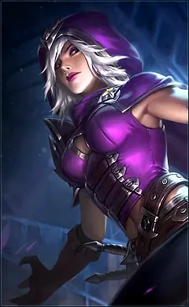

[Скины Натальи](https://boostmlbb.ru/skins/natalia.html)

[Скины](https://boostmlbb.ru/skins/)/[Наталья](https://boostmlbb.ru/skins/natalia.html)/Смертоносная мамба

[Скин Натальи](https://boostmlbb.ru/skins/natalia.html)

# Смертоносная мамба

Deadly Mamba

Обычный CommonЭлитныйОграниченный

Как получить

Выходил в магазине обликов во время события. Ограниченные облики иногда возвращаются в розыгрышах событий.

Вышел

2018 год

## Что меняет облик

-   Новая внешность
-   Другой цвет эффектов
-   Анимация показа
-   Бонус к характеристикам

## Перекраски

Тот же облик в других цветах. Перекраска открывается, только если у вас уже есть сам облик.

-   **Мамба-разбойница** Rogue MambaНаграда из небесного сундука.

## Все скины Натальи [8](https://boostmlbb.ru/skins/natalia.html)

[Охотница за душамиДелюкс · 2025](https://boostmlbb.ru/skins/natalia/soul-huntress.html)[Образцовая вои­тельницаИзысканный · 2024](https://boostmlbb.ru/skins/natalia/warrioress-paragon.html)[Кибер-призракИсключительный · 2020](https://boostmlbb.ru/skins/natalia/cyber-spectre.html)[Мрачная души­тельницаИсключительный · 2020](https://boostmlbb.ru/skins/natalia/grim-strangler.html)[Полуночный воронИсключительный · 2018](https://boostmlbb.ru/skins/natalia/midnight-raven.html)[Смерто­носная мамбаОбычный · 2018](https://boostmlbb.ru/skins/natalia/deadly-mamba.html)[Призрачная танцовщицаИсключительный · 2017](https://boostmlbb.ru/skins/natalia/phantom-dancer.html)[Стеклянный клинокОбычный · 2016](https://boostmlbb.ru/skins/natalia/glass-blade.html)

## Серия «Элитный»

[Золотой османтусЧан'Э · 2026](https://boostmlbb.ru/skins/change/golden-osmanthus.html)[Король-воена­чальникМартис · 2025](https://boostmlbb.ru/skins/martis/warlord-king.html)[Кадет открытого моряКимми · 2024](https://boostmlbb.ru/skins/kimmy/high-seas-cadet.html)[Зелёная копейщицаСильвана · 2024](https://boostmlbb.ru/skins/silvanna/verdant-lancer.html)[Мародёр Кровавое КопытоХилос · 2024](https://boostmlbb.ru/skins/hylos/bloodhoof-marauder.html)[Изящная бабочкаГвиневра · 2024](https://boostmlbb.ru/skins/guinevere/elegant-butterfly.html)[Маркиз клинковЛанселот · 2024](https://boostmlbb.ru/skins/lancelot/marques-of-blades.html)[Привал в пустошахЧип · 2024](https://boostmlbb.ru/skins/chip/badlands-hiatus.html)

**Сколько стоит буст на герое Наталья?**Выберите текущий и желаемый ранг. Стоимость появится на сайте.

[Рассчитать цену](https://boostmlbb.ru/order.html?type=hero)

## Частые вопросы

Как получить скин «Смертоносная мамба» на Наталью?

Выходил в магазине обликов во время события. Ограниченные облики иногда возвращаются в розыгрышах событий.

Когда вышел скин «Смертоносная мамба»?

2018 год.

Какой класс у скина «Смертоносная мамба»?

Обычный (Common), серия «Элитный».
