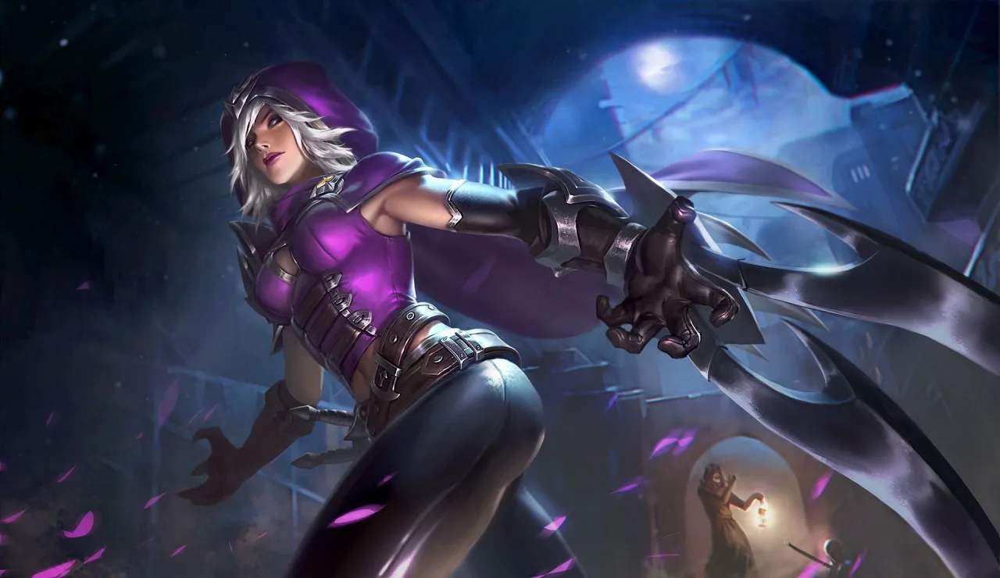

[Тир-лист](https://boostmlbb.ru/heroes/)[Предметы](https://boostmlbb.ru/items/)[Скины](https://boostmlbb.ru/skins/)[Новости и гайды](https://boostmlbb.ru/news/)

[Скины](https://boostmlbb.ru/skins/)/[Наталья](https://boostmlbb.ru/skins/natalia.html)/Стеклянный клинок

[Скин Натальи](https://boostmlbb.ru/skins/natalia.html)

# Стеклянный клинок

Glass Blade

Обычный CommonВ продаже

Как получить

Продаётся в магазине обликов за 269 алмазов.

Цена

269 алмазов

Вышел

2016 год

## Что меняет облик

-   Бонус к характеристикам

## Все скины Натальи [8](https://boostmlbb.ru/skins/natalia.html)

[Охотница за душамиДелюкс · 2025](https://boostmlbb.ru/skins/natalia/soul-huntress.html)[Образцовая вои­тельницаИзысканный · 2024](https://boostmlbb.ru/skins/natalia/warrioress-paragon.html)[Кибер-призракИсключительный · 2020](https://boostmlbb.ru/skins/natalia/cyber-spectre.html)[Мрачная души­тельницаИсключительный · 2020](https://boostmlbb.ru/skins/natalia/grim-strangler.html)[Полуночный воронИсключительный · 2018](https://boostmlbb.ru/skins/natalia/midnight-raven.html)[Смерто­носная мамбаОбычный · 2018](https://boostmlbb.ru/skins/natalia/deadly-mamba.html)[Призрачная танцовщицаИсключительный · 2017](https://boostmlbb.ru/skins/natalia/phantom-dancer.html)[Стеклянный клинокОбычный · 2016](https://boostmlbb.ru/skins/natalia/glass-blade.html)

**Поднимем ранг на герое Наталья**Цена считается в калькуляторе

[Рассчитать цену](https://boostmlbb.ru/order.html?type=hero)

## Частые вопросы

Как получить скин «Стеклянный клинок» на Наталью?

Продаётся в магазине обликов за 269 алмазов.

Когда вышел скин «Стеклянный клинок»?

2016 год.

Какой класс у скина «Стеклянный клинок»?

Обычный (Common).
