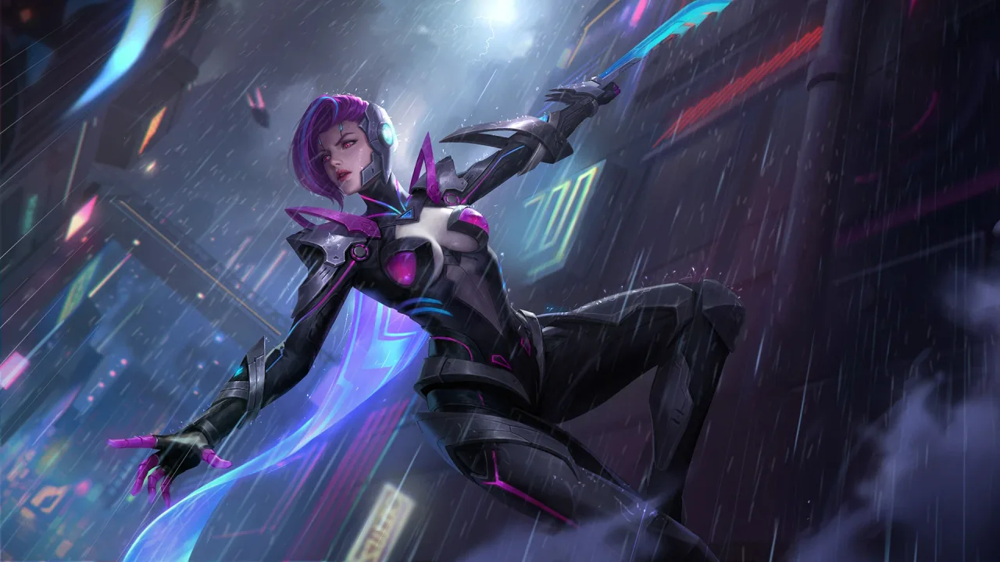

[Скины Натальи](https://boostmlbb.ru/skins/natalia.html)

[Скины](https://boostmlbb.ru/skins/)/[Наталья](https://boostmlbb.ru/skins/natalia.html)/Мрачная душительница

[Скин Натальи](https://boostmlbb.ru/skins/natalia.html)

# Мрачная душительница

Grim Strangler

Исключительный ExceptionalОсобыйОграниченный

Как получить

Выходил в магазине обликов во время события. Ограниченные облики иногда возвращаются в розыгрышах событий.

Вышел

2020 год

## Что меняет облик

-   Новая внешность
-   Новые эффекты навыков
-   Анимация показа
-   Бонус к характеристикам

## Все скины Натальи [8](https://boostmlbb.ru/skins/natalia.html)

[Охотница за душамиДелюкс · 2025](https://boostmlbb.ru/skins/natalia/soul-huntress.html)[Образцовая вои­тельницаИзысканный · 2024](https://boostmlbb.ru/skins/natalia/warrioress-paragon.html)[Кибер-призракИсключительный · 2020](https://boostmlbb.ru/skins/natalia/cyber-spectre.html)[Мрачная души­тельницаИсключительный · 2020](https://boostmlbb.ru/skins/natalia/grim-strangler.html)[Полуночный воронИсключительный · 2018](https://boostmlbb.ru/skins/natalia/midnight-raven.html)[Смерто­носная мамбаОбычный · 2018](https://boostmlbb.ru/skins/natalia/deadly-mamba.html)[Призрачная танцовщицаИсключительный · 2017](https://boostmlbb.ru/skins/natalia/phantom-dancer.html)[Стеклянный клинокОбычный · 2016](https://boostmlbb.ru/skins/natalia/glass-blade.html)

## Серия «Особый»

[Тайный вердиктМатильда · 2026](https://boostmlbb.ru/skins/mathilda/arcane-verdict.html)[Вальс на ветруВэйл · 2026](https://boostmlbb.ru/skins/vale/windborne-waltz.html)[Капитан потерянныхФранко · 2026](https://boostmlbb.ru/skins/franco/captain-of-the-lost.html)[ВолнорезЛи Сун-Син · 2025](https://boostmlbb.ru/skins/yi-sun-shin/wavebreaker.html)[Стальные рукиБаданг · 2025](https://boostmlbb.ru/skins/badang/steel-arms.html)[Леди с зонтикомКагура · 2025](https://boostmlbb.ru/skins/kagura/lady-parasol.html)[Ужас пучиныАлдос · 2025](https://boostmlbb.ru/skins/aldous/fathom-terror.html)[Труппа лунного светаЧан'Э · 2025](https://boostmlbb.ru/skins/change/moonglow-troupe.html)

**Сколько стоит буст на герое Наталья?**Выберите текущий и желаемый ранг. Стоимость появится на сайте.

[Рассчитать цену](https://boostmlbb.ru/order.html?type=hero)

## Частые вопросы

Как получить скин «Мрачная душительница» на Наталью?

Выходил в магазине обликов во время события. Ограниченные облики иногда возвращаются в розыгрышах событий.

Когда вышел скин «Мрачная душительница»?

2020 год.

Какой класс у скина «Мрачная душительница»?

Исключительный (Exceptional), серия «Особый».
