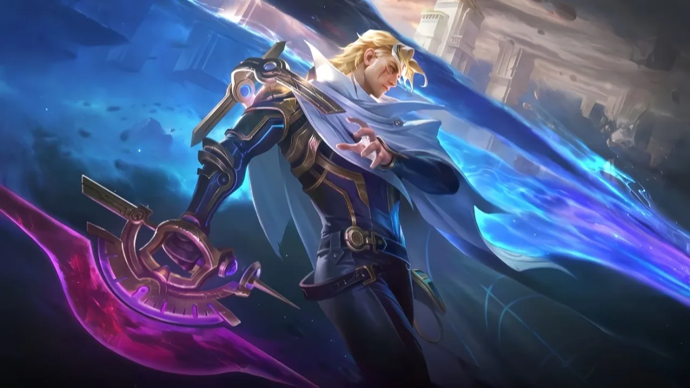

[Все скины](https://boostmlbb.ru/skins/)

[Скины](https://boostmlbb.ru/skins/)/Нолан

# Скины Нолана

Скинов

3

Можно купить

1

Последний

[Навигатор](https://boostmlbb.ru/skins/nolan/the-navigator.html)2024

[Профиль героя→](https://boostmlbb.ru/heroes/nolan.html)

## Все скины

[НавигаторГрандиозный · 2024](https://boostmlbb.ru/skins/nolan/the-navigator.html)[Магнат модыИсключительный · 2024](https://boostmlbb.ru/skins/nolan/fashion-mogul.html)[Странник пустотыОбычный · 2023](https://boostmlbb.ru/skins/nolan/voidwalker.html)

**Сколько стоит буст на герое Нолан?**Выберите текущий и желаемый ранг. Стоимость появится на сайте.

[Рассчитать цену](https://boostmlbb.ru/order.html?type=hero)

## Частые вопросы

Сколько скинов у Нолана?

3 скина без стандартного облика. Последний — «Навигатор» (The Navigator), ноябрь 2024.

Какие скины Нолана можно купить сейчас?

«Странник пустоты» (269 алмазов). Остальные облики ограниченные и возвращаются только в событиях.

Какой самый редкий скин Нолана?

«Навигатор» (The Navigator), класс грандиозный, серия «Распродажа 11.11». Выходил в магазине обликов во время события. Ограниченные облики иногда возвращаются в розыгрышах событий.
