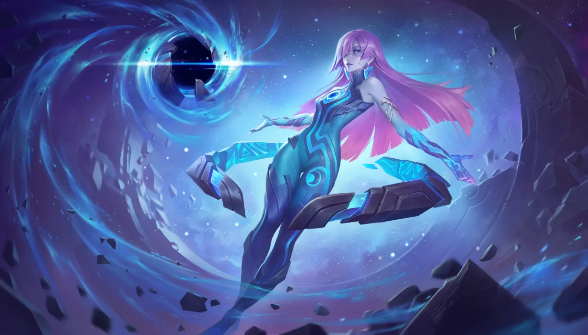
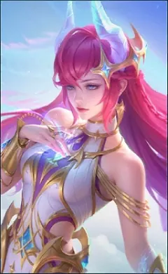
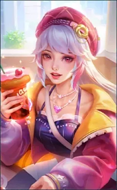

[Тир-лист](https://boostmlbb.ru/heroes/)[Предметы](https://boostmlbb.ru/items/)[Скины](https://boostmlbb.ru/skins/)[Новости и гайды](https://boostmlbb.ru/news/)

[Скины](https://boostmlbb.ru/skins/)/Новария

# Скины Новарии

Скинов

3

Можно купить

1

Последний

[Присяг­нувшая дракону](https://boostmlbb.ru/skins/novaria/dragonsworn.html)2025

[Профиль героя→](https://boostmlbb.ru/heroes/novaria.html)

## Все скины

[Присяг­нувшая драконуИзысканный · 2025](https://boostmlbb.ru/skins/novaria/dragonsworn.html)[Сахарная глазурьИсключительный · 2024](https://boostmlbb.ru/skins/novaria/sugar-glaze.html)[Тёмная звездаОбычный · 2023](https://boostmlbb.ru/skins/novaria/dark-star.html)

**Поднимем ранг на герое Новария**Цена считается в калькуляторе

[Рассчитать цену](https://boostmlbb.ru/order.html?type=hero)

## Частые вопросы

Сколько скинов у Новарии?

3 скина без стандартного облика. Последний — «Присягнувшая дракону» (Dragonsworn), 3 сентября 2025.

Какие скины Новарии можно купить сейчас?

«Тёмная звезда» (269 алмазов). Остальные облики ограниченные и возвращаются только в событиях.

Какой самый редкий скин Новарии?

«Присягнувшая дракону» (Dragonsworn), класс изысканный, серия «Коллекционный». Главный приз розыгрыша в коллекционном событии, попытки покупаются за алмазы. Ограниченные облики иногда возвращаются в розыгрышах событий.
