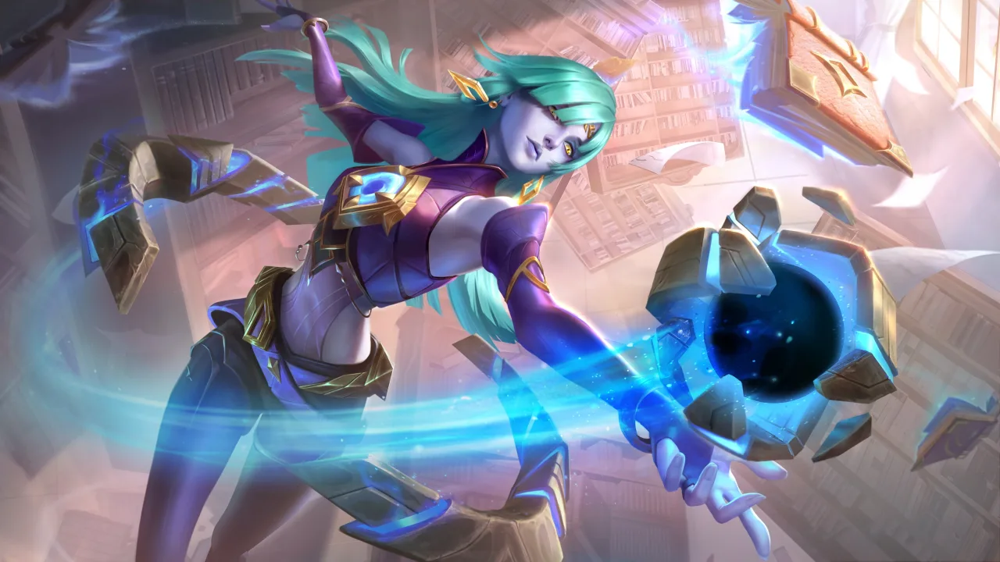

[Скины Новарии](https://boostmlbb.ru/skins/novaria.html)

[Скины](https://boostmlbb.ru/skins/)/[Новария](https://boostmlbb.ru/skins/novaria.html)/Тёмная звезда

[Скин Новарии](https://boostmlbb.ru/skins/novaria.html)

# Тёмная звезда

Dark Star

Обычный CommonВ продаже

Как получить

Продаётся в магазине обликов за 269 алмазов.

Цена

269 алмазов

Вышел

16 мая 2023

## Что меняет облик

-   Бонус к характеристикам

## Все скины Новарии [3](https://boostmlbb.ru/skins/novaria.html)

[Присяг­нувшая драконуИзысканный · 2025](https://boostmlbb.ru/skins/novaria/dragonsworn.html)[Сахарная глазурьИсключительный · 2024](https://boostmlbb.ru/skins/novaria/sugar-glaze.html)[Тёмная звездаОбычный · 2023](https://boostmlbb.ru/skins/novaria/dark-star.html)

**Сколько стоит буст на герое Новария?**Выберите текущий и желаемый ранг. Стоимость появится на сайте.

[Рассчитать цену](https://boostmlbb.ru/order.html?type=hero)

## Частые вопросы

Как получить скин «Тёмная звезда» на Новарию?

Продаётся в магазине обликов за 269 алмазов.

Когда вышел скин «Тёмная звезда»?

16 мая 2023.

Какой класс у скина «Тёмная звезда»?

Обычный (Common).
