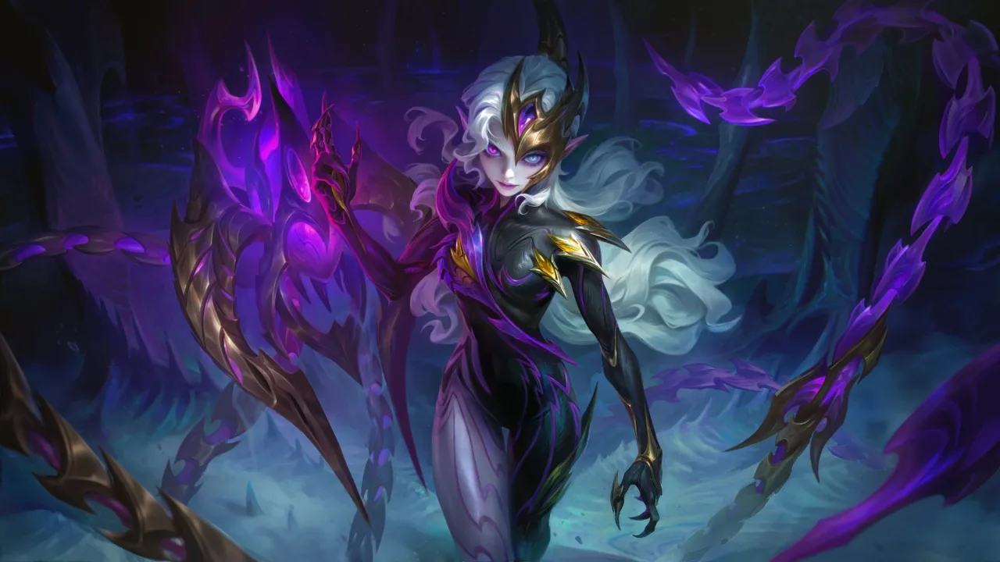

[Тир-лист](https://boostmlbb.ru/heroes/)[Предметы](https://boostmlbb.ru/items/)[Скины](https://boostmlbb.ru/skins/)[Новости и гайды](https://boostmlbb.ru/news/)

[Скины](https://boostmlbb.ru/skins/)/Обсидия

# Скины Обсидии

Скинов

3

Можно купить

1

Последний

[Импе­ратрица Араси](https://boostmlbb.ru/skins/obsidia/imperatrix-arashi.html)2026

[Профиль героя→](https://boostmlbb.ru/heroes/obsidia.html)

## Все скины

[Импе­ратрица АрасиГрандиозный · 2026](https://boostmlbb.ru/skins/obsidia/imperatrix-arashi.html)[Магитех­нический призрак2026](https://boostmlbb.ru/skins/obsidia/magitech-wraith.html)[Неуми­рающие останкиОбычный · 2025](https://boostmlbb.ru/skins/obsidia/undying-remnants.html)

**Поднимем ранг на герое Обсидия**Цена считается в калькуляторе

[Рассчитать цену](https://boostmlbb.ru/order.html?type=hero)

## Частые вопросы

Сколько скинов у Обсидии?

3 скина без стандартного облика. Последний — «Императрица Араси» (Imperatrix Arashi), 9 октября 2026.

Какие скины Обсидии можно купить сейчас?

«Неумирающие останки» (269 алмазов). Остальные облики ограниченные и возвращаются только в событиях.

Какой самый редкий скин Обсидии?

«Императрица Араси» (Imperatrix Arashi), класс грандиозный, серия «Претенденты». Выходил в событии «Претенденты». Ограниченные облики иногда возвращаются в розыгрышах событий.
