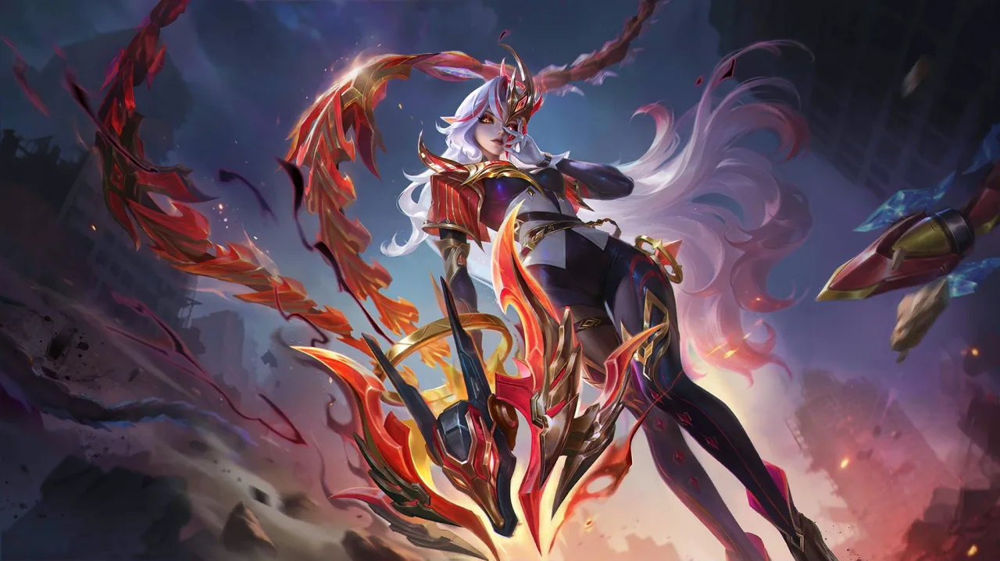

[Скины Обсидии](https://boostmlbb.ru/skins/obsidia.html)

[Скины](https://boostmlbb.ru/skins/)/[Обсидия](https://boostmlbb.ru/skins/obsidia.html)/Магитехнический призрак

[Скин Обсидии](https://boostmlbb.ru/skins/obsidia.html)

# Магитехнический призрак

Magitech Wraith

Звёздный участникОграниченный

Как получить

Облик «Звёздного участника» в мае 2026: его выдавали за покупку звёздного пропуска в этом месяце. Ограниченные облики иногда возвращаются в розыгрышах событий.

Вышел

май 2026

## Что меняет облик

-   Новая внешность
-   Новые эффекты навыков
-   Звуки навыков
-   Своя озвучка
-   Иконки навыков
-   Анимация показа
-   Сцена показа
-   Музыка показа
-   Анимация появления
-   Особые действия
-   Бонус к характеристикам

## Все скины Обсидии [3](https://boostmlbb.ru/skins/obsidia.html)

[Импе­ратрица АрасиГрандиозный · 2026](https://boostmlbb.ru/skins/obsidia/imperatrix-arashi.html)[Магитех­нический призрак2026](https://boostmlbb.ru/skins/obsidia/magitech-wraith.html)[Неуми­рающие останкиОбычный · 2025](https://boostmlbb.ru/skins/obsidia/undying-remnants.html)

## Серия «Звёздный участник»

[Морячка, рождённая приливомКалеа · 2026](https://boostmlbb.ru/skins/kalea/tideborn-sailor.html)[Тень кицунэХаябуса · 2026](https://boostmlbb.ru/skins/hayabusa/kitsune-s-shadow.html)[Клыки резниХанзо · 2026](https://boostmlbb.ru/skins/hanzo/fangs-of-slaughter.html)[Тлеющая крепостьБелерик · 2026](https://boostmlbb.ru/skins/belerick/smouldering-fortress.html)[Элизийское сияниеЦзэтянь · 2026](https://boostmlbb.ru/skins/zetian/elysian-luminance.html)[Батальон стражейХильда · 2026](https://boostmlbb.ru/skins/hilda/guardian-battalion.html)[Мечта­тельный коиХарли · 2026](https://boostmlbb.ru/skins/harley/dreaming-koi.html)[Коро­левский маршалФредрин · 2025](https://boostmlbb.ru/skins/fredrinn/royal-marshal.html)

**Сколько стоит буст на герое Обсидия?**Выберите текущий и желаемый ранг. Стоимость появится на сайте.

[Рассчитать цену](https://boostmlbb.ru/order.html?type=hero)

## Частые вопросы

Как получить скин «Магитехнический призрак» на Обсидию?

Облик «Звёздного участника» в мае 2026: его выдавали за покупку звёздного пропуска в этом месяце. Ограниченные облики иногда возвращаются в розыгрышах событий.

Когда вышел скин «Магитехнический призрак»?

Май 2026.
