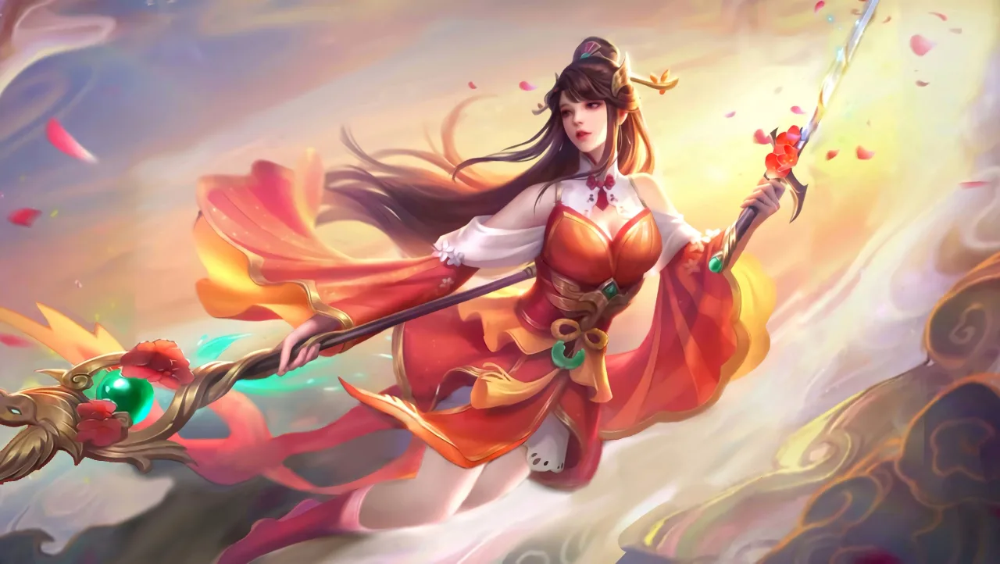
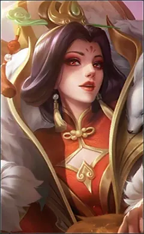

[Тир-лист](https://boostmlbb.ru/heroes/)[Предметы](https://boostmlbb.ru/items/)[Скины](https://boostmlbb.ru/skins/)[Новости и гайды](https://boostmlbb.ru/news/)

[Скины](https://boostmlbb.ru/skins/)/[Одетта](https://boostmlbb.ru/skins/odette.html)/Благая удача

[Скин Одетты](https://boostmlbb.ru/skins/odette.html)

# Благая удача

Auspicious Charm

Исключительный ExceptionalЛунный фестивальОграниченный

Как получить

Выходил в магазине обликов во время события. Ограниченные облики иногда возвращаются в розыгрышах событий.

Вышел

2 ноября 2019

## Что меняет облик

-   Новая внешность
-   Новые эффекты навыков
-   Анимация показа
-   Сцена показа
-   Бонус к характеристикам

## Все скины Одетты [9](https://boostmlbb.ru/skins/odette.html)

[Песнь предан­ностиИзысканный · 2026](https://boostmlbb.ru/skins/odette/song-of-devotion.html)[Мудрость звёздИсключительный · 2024](https://boostmlbb.ru/skins/odette/wisdom-of-the-stars.html)[Мудрица теченийДелюкс · 2020](https://boostmlbb.ru/skins/odette/sage-of-the-currents.html)[Благая удачаИсключительный · 2019](https://boostmlbb.ru/skins/odette/auspicious-charm.html)[ДеваДелюкс · 2019](https://boostmlbb.ru/skins/odette/virgo.html)[Принцесса-русалкаИзысканный · 2018](https://boostmlbb.ru/skins/odette/mermaid-princess.html)[Богиня-бабочкаИсключительный · 2018](https://boostmlbb.ru/skins/odette/butterfly-goddess.html)[Рож­дественский карнавалИсключительный · 2018](https://boostmlbb.ru/skins/odette/christmas-carnival.html)[Чёрный лебедьОбычный · 2017](https://boostmlbb.ru/skins/odette/black-swan.html)

## Серия «Лунный фестиваль»

[Благое пламяЛеоморд · 2026](https://boostmlbb.ru/skins/leomord/auspicious-blaze.html)[Цветение изобилияРафаэль · 2025](https://boostmlbb.ru/skins/rafaela/bloom-of-abundance.html)[Дракон процве­танияЗилонг · 2024](https://boostmlbb.ru/skins/zilong/dragon-of-prosperity.html)[НоволуниеЧан'Э · 2023](https://boostmlbb.ru/skins/change/new-moon.html)[Весенние благос­ловенияСан · 2022](https://boostmlbb.ru/skins/sun/spring-blessings.html)[Рассветная удачаЛо Йи · 2021](https://boostmlbb.ru/skins/luo-yi/dawning-fortune.html)[Танец льваЛолита · 2019](https://boostmlbb.ru/skins/lolita/lion-dance.html)[Лисья ледиАврора · 2018](https://boostmlbb.ru/skins/aurora/foxy-lady.html)

**Поднимем ранг на герое Одетта**Цена считается в калькуляторе

[Рассчитать цену](https://boostmlbb.ru/order.html?type=hero)

## Частые вопросы

Как получить скин «Благая удача» на Одетту?

Выходил в магазине обликов во время события. Ограниченные облики иногда возвращаются в розыгрышах событий.

Когда вышел скин «Благая удача»?

2 ноября 2019.

Какой класс у скина «Благая удача»?

Исключительный (Exceptional), серия «Лунный фестиваль».
