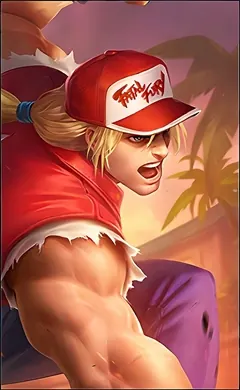

[Тир-лист](https://boostmlbb.ru/heroes/)[Предметы](https://boostmlbb.ru/items/)[Скины](https://boostmlbb.ru/skins/)[Новости и гайды](https://boostmlbb.ru/news/)

[Скины](https://boostmlbb.ru/skins/)/[Пакито](https://boostmlbb.ru/skins/paquito.html)/Кулак славы

[Скин Пакито](https://boostmlbb.ru/skins/paquito.html)

# Кулак славы

Fist of Glory

Делюкс DeluxeMVP финалаОграниченный

Как получить

Киберспортивный облик (MVP финала): выходил в событии турнира. Ограниченные облики иногда возвращаются в розыгрышах событий.

Вышел

19 сентября 2024

## Что меняет облик

-   Новая внешность
-   Новые эффекты навыков
-   Звуки навыков
-   Своя озвучка
-   Анимация показа
-   Сцена показа
-   Музыка показа
-   Бонус к характеристикам

## Все скины Пакито [8](https://boostmlbb.ru/skins/paquito.html)

[Кулак славыДелюкс · 2024](https://boostmlbb.ru/skins/paquito/fist-of-glory.html)[Терри БогардГрандиозный · 2024](https://boostmlbb.ru/skins/paquito/terry-bogard.html)[Пылающий тигрИзысканный · 2023](https://boostmlbb.ru/skins/paquito/blazing-tiger.html)[Кулак светаИсключительный · 2022](https://boostmlbb.ru/skins/paquito/fist-of-light.html)[Сверкающий ударИсключительный · 2022](https://boostmlbb.ru/skins/paquito/fulgent-punch.html)[Подпольный боксёрИсключительный · 2021](https://boostmlbb.ru/skins/paquito/underground-boxer.html)[Мэнни ПакьяоДелюкс · 2021](https://boostmlbb.ru/skins/paquito/manny-pacquiao.html)[Смер­тельный ударОбычный · 2021](https://boostmlbb.ru/skins/paquito/death-blow.html)

## Серия «MVP финала»

[Небесный асБеатрис · 2025](https://boostmlbb.ru/skins/beatrix/sky-force-maverick.html)

**Поднимем ранг на герое Пакито**Цена считается в калькуляторе

[Рассчитать цену](https://boostmlbb.ru/order.html?type=hero)

## Частые вопросы

Как получить скин «Кулак славы» на Пакито?

Киберспортивный облик (MVP финала): выходил в событии турнира. Ограниченные облики иногда возвращаются в розыгрышах событий.

Когда вышел скин «Кулак славы»?

19 сентября 2024.

Какой класс у скина «Кулак славы»?

Делюкс (Deluxe), серия «MVP финала».
