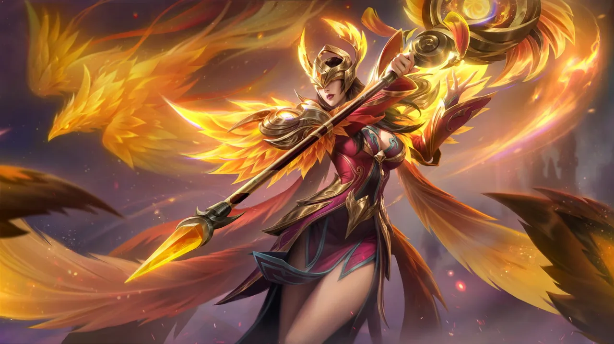

[Скины Фаши](https://boostmlbb.ru/skins/pharsa.html)

[Скины](https://boostmlbb.ru/skins/)/[Фаша](https://boostmlbb.ru/skins/pharsa.html)/Императрица-феникс

[Скин Фаши](https://boostmlbb.ru/skins/pharsa.html)

# Императрица-феникс

Empress Phoenix

Изысканный ExquisiteКоллекционныйОграниченный

Как получить

Главный приз розыгрыша в коллекционном событии, попытки покупаются за алмазы. Ограниченные облики иногда возвращаются в розыгрышах событий.

Вышел

6 августа 2020

## Что меняет облик

-   Новая внешность
-   Новые эффекты навыков
-   Анимация показа
-   Сцена показа
-   Бонус к характеристикам

## Все скины Фаши [10](https://boostmlbb.ru/skins/pharsa.html)

[Фаша NeobeastГрандиозный · 2025](https://boostmlbb.ru/skins/pharsa/neobeast-pharsa.html)[Неоновое новолуниеДелюкс · 2023](https://boostmlbb.ru/skins/pharsa/neon-shingetsu.html)[ИерофантДелюкс · 2022](https://boostmlbb.ru/skins/pharsa/hierophant.html)[Муза самбыИсключительный · 2022](https://boostmlbb.ru/skins/pharsa/samba-muse.html)[Цветение пионаИсключительный · 2021](https://boostmlbb.ru/skins/pharsa/peony-bloom.html)[Импе­ратрица-фениксИзысканный · 2020](https://boostmlbb.ru/skins/pharsa/empress-phoenix.html)[Чарующая ведьмаОбычный · 2019](https://boostmlbb.ru/skins/pharsa/enchanting-witch.html)[Лётчица индигоОбычный · 2019](https://boostmlbb.ru/skins/pharsa/indigo-aviatrix.html)[Танец павлинаОбычный · 2018](https://boostmlbb.ru/skins/pharsa/peafowl-s-dance.html)[Крылья небесОбычный · 2017](https://boostmlbb.ru/skins/pharsa/wings-of-heaven.html)

## Серия «Коллекционный»

[ОчистительБруно · 2026](https://boostmlbb.ru/skins/bruno/the-purifier.html)[Небесный бунтарьСан · 2026](https://boostmlbb.ru/skins/sun/celestial-rebel.html)[Кайдзю глубинХелкарт · 2026](https://boostmlbb.ru/skins/helcurt/kaiju-of-the-deep.html)[Звёздный дозорныйКимми · 2026](https://boostmlbb.ru/skins/kimmy/starbound-sentry.html)[Монархиня грёзАлиса · 2026](https://boostmlbb.ru/skins/alice/dreaming-monarch.html)[Дрожь глубинГрок · 2026](https://boostmlbb.ru/skins/grock/tremor-of-the-deep.html)[Небесный генералТигрил · 2026](https://boostmlbb.ru/skins/tigreal/celestial-general.html)[Монарх, рождённый солнцемКсавьер · 2026](https://boostmlbb.ru/skins/xavier/sunborn-monarch.html)

**Сколько стоит буст на герое Фаша?**Выберите текущий и желаемый ранг. Стоимость появится на сайте.

[Рассчитать цену](https://boostmlbb.ru/order.html?type=hero)

## Частые вопросы

Как получить скин «Императрица-феникс» на Фашу?

Главный приз розыгрыша в коллекционном событии, попытки покупаются за алмазы. Ограниченные облики иногда возвращаются в розыгрышах событий.

Когда вышел скин «Императрица-феникс»?

6 августа 2020.

Какой класс у скина «Императрица-феникс»?

Изысканный (Exquisite), серия «Коллекционный».
