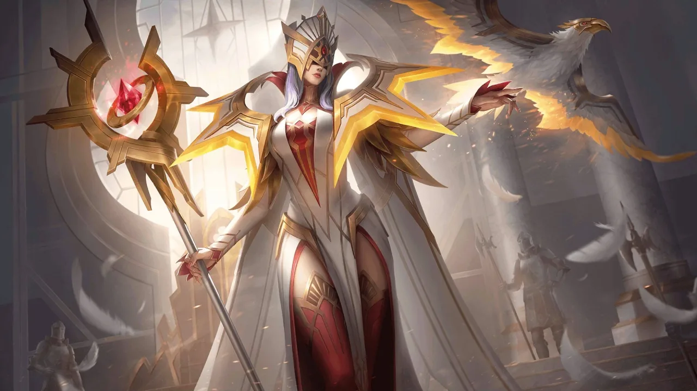

[Скины Фаши](https://boostmlbb.ru/skins/pharsa.html)

[Скины](https://boostmlbb.ru/skins/)/[Фаша](https://boostmlbb.ru/skins/pharsa.html)/Иерофант

[Скин Фаши](https://boostmlbb.ru/skins/pharsa.html)

# Иерофант

Hierophant

Делюкс DeluxeMSC 2022Ограниченный

Как получить

Киберспортивный облик (MSC 2022): выходил в событии турнира. Ограниченные облики иногда возвращаются в розыгрышах событий.

Вышел

7 июня 2022

## Что меняет облик

-   Новая внешность
-   Новые эффекты навыков
-   Анимация показа
-   Сцена показа
-   Бонус к характеристикам

## Все скины Фаши [10](https://boostmlbb.ru/skins/pharsa.html)

[Фаша NeobeastГрандиозный · 2025](https://boostmlbb.ru/skins/pharsa/neobeast-pharsa.html)[Неоновое новолуниеДелюкс · 2023](https://boostmlbb.ru/skins/pharsa/neon-shingetsu.html)[ИерофантДелюкс · 2022](https://boostmlbb.ru/skins/pharsa/hierophant.html)[Муза самбыИсключительный · 2022](https://boostmlbb.ru/skins/pharsa/samba-muse.html)[Цветение пионаИсключительный · 2021](https://boostmlbb.ru/skins/pharsa/peony-bloom.html)[Импе­ратрица-фениксИзысканный · 2020](https://boostmlbb.ru/skins/pharsa/empress-phoenix.html)[Чарующая ведьмаОбычный · 2019](https://boostmlbb.ru/skins/pharsa/enchanting-witch.html)[Лётчица индигоОбычный · 2019](https://boostmlbb.ru/skins/pharsa/indigo-aviatrix.html)[Танец павлинаОбычный · 2018](https://boostmlbb.ru/skins/pharsa/peafowl-s-dance.html)[Крылья небесОбычный · 2017](https://boostmlbb.ru/skins/pharsa/wings-of-heaven.html)

**Сколько стоит буст на герое Фаша?**Выберите текущий и желаемый ранг. Стоимость появится на сайте.

[Рассчитать цену](https://boostmlbb.ru/order.html?type=hero)

## Частые вопросы

Как получить скин «Иерофант» на Фашу?

Киберспортивный облик (MSC 2022): выходил в событии турнира. Ограниченные облики иногда возвращаются в розыгрышах событий.

Когда вышел скин «Иерофант»?

7 июня 2022.

Какой класс у скина «Иерофант»?

Делюкс (Deluxe), серия «MSC 2022».
