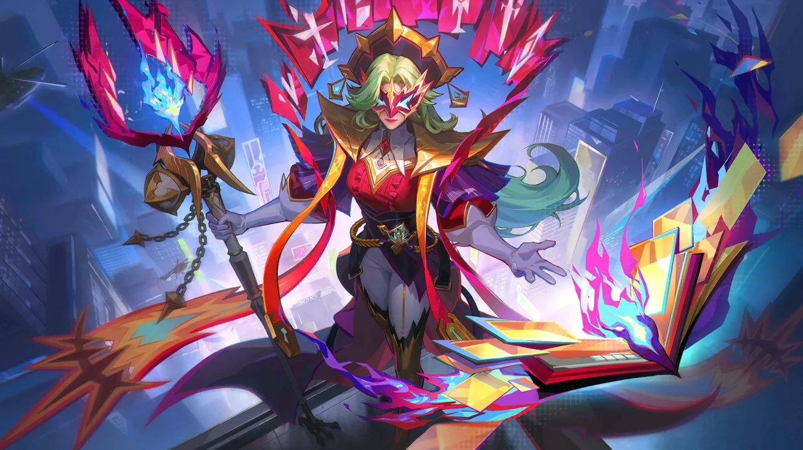

[Тир-лист](https://boostmlbb.ru/heroes/)[Предметы](https://boostmlbb.ru/items/)[Скины](https://boostmlbb.ru/skins/)[Новости и гайды](https://boostmlbb.ru/news/)

[Скины](https://boostmlbb.ru/skins/)/[Фаша](https://boostmlbb.ru/skins/pharsa.html)/Фаша Neobeast

[Скин Фаши](https://boostmlbb.ru/skins/pharsa.html)

# Фаша Neobeast

Neobeast Pharsa

Грандиозный GrandNeobeastОграниченный

Как получить

Выходил в событии «Neobeast». Ограниченные облики иногда возвращаются в розыгрышах событий.

Вышел

12 апреля 2025

## Что меняет облик

-   Новая внешность
-   Новые эффекты навыков
-   Звуки навыков
-   Своя озвучка
-   Иконки навыков
-   Анимация показа
-   Сцена показа
-   Музыка показа
-   Анимация появления
-   Особые действия
-   Бонус к характеристикам

## Все скины Фаши [10](https://boostmlbb.ru/skins/pharsa.html)

[Фаша NeobeastГрандиозный · 2025](https://boostmlbb.ru/skins/pharsa/neobeast-pharsa.html)[Неоновое новолуниеДелюкс · 2023](https://boostmlbb.ru/skins/pharsa/neon-shingetsu.html)[ИерофантДелюкс · 2022](https://boostmlbb.ru/skins/pharsa/hierophant.html)[Муза самбыИсключительный · 2022](https://boostmlbb.ru/skins/pharsa/samba-muse.html)[Цветение пионаИсключительный · 2021](https://boostmlbb.ru/skins/pharsa/peony-bloom.html)[Импе­ратрица-фениксИзысканный · 2020](https://boostmlbb.ru/skins/pharsa/empress-phoenix.html)[Чарующая ведьмаОбычный · 2019](https://boostmlbb.ru/skins/pharsa/enchanting-witch.html)[Лётчица индигоОбычный · 2019](https://boostmlbb.ru/skins/pharsa/indigo-aviatrix.html)[Танец павлинаОбычный · 2018](https://boostmlbb.ru/skins/pharsa/peafowl-s-dance.html)[Крылья небесОбычный · 2017](https://boostmlbb.ru/skins/pharsa/wings-of-heaven.html)

## Серия «Neobeast»

[Линг NeobeastЛинг · 2025](https://boostmlbb.ru/skins/ling/neobeast-ling.html)[Броуди NeobeastБроуди · 2025](https://boostmlbb.ru/skins/brody/neobeast-brody.html)

**Поднимем ранг на герое Фаша**Цена считается в калькуляторе

[Рассчитать цену](https://boostmlbb.ru/order.html?type=hero)

## Частые вопросы

Как получить скин «Фаша Neobeast» на Фашу?

Выходил в событии «Neobeast». Ограниченные облики иногда возвращаются в розыгрышах событий.

Когда вышел скин «Фаша Neobeast»?

12 апреля 2025.

Какой класс у скина «Фаша Neobeast»?

Грандиозный (Grand), серия «Neobeast».
