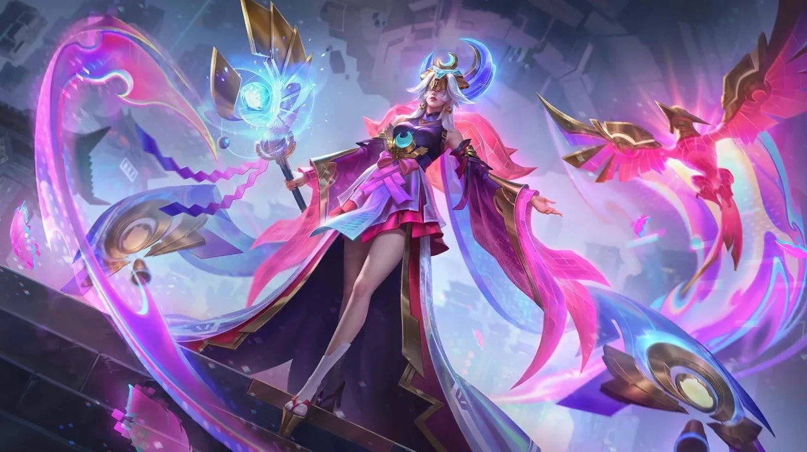
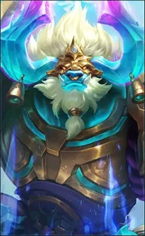

[Скины Фаши](https://boostmlbb.ru/skins/pharsa.html)

[Скины](https://boostmlbb.ru/skins/)/[Фаша](https://boostmlbb.ru/skins/pharsa.html)/Неоновое новолуние

[Скин Фаши](https://boostmlbb.ru/skins/pharsa.html)

# Неоновое новолуние

Neon Shingetsu

Делюкс DeluxeЭпическийВ продаже

Как получить

Продаётся в магазине обликов за 899 алмазов.

Цена

899 алмазов

Вышел

16 октября 2023

## Что меняет облик

-   Новая внешность
-   Новые эффекты навыков
-   Звуки навыков
-   Анимация показа
-   Сцена показа
-   Музыка показа
-   Бонус к характеристикам

## Все скины Фаши [10](https://boostmlbb.ru/skins/pharsa.html)

[Фаша NeobeastГрандиозный · 2025](https://boostmlbb.ru/skins/pharsa/neobeast-pharsa.html)[Неоновое новолуниеДелюкс · 2023](https://boostmlbb.ru/skins/pharsa/neon-shingetsu.html)[ИерофантДелюкс · 2022](https://boostmlbb.ru/skins/pharsa/hierophant.html)[Муза самбыИсключительный · 2022](https://boostmlbb.ru/skins/pharsa/samba-muse.html)[Цветение пионаИсключительный · 2021](https://boostmlbb.ru/skins/pharsa/peony-bloom.html)[Импе­ратрица-фениксИзысканный · 2020](https://boostmlbb.ru/skins/pharsa/empress-phoenix.html)[Чарующая ведьмаОбычный · 2019](https://boostmlbb.ru/skins/pharsa/enchanting-witch.html)[Лётчица индигоОбычный · 2019](https://boostmlbb.ru/skins/pharsa/indigo-aviatrix.html)[Танец павлинаОбычный · 2018](https://boostmlbb.ru/skins/pharsa/peafowl-s-dance.html)[Крылья небесОбычный · 2017](https://boostmlbb.ru/skins/pharsa/wings-of-heaven.html)

## Серия «Эпический»

[Надзи­ратель преис­поднейМинотавр · 2026](https://boostmlbb.ru/skins/minotaur/nether-overseer.html)[Затонувшее проклятиеАтлас · 2026](https://boostmlbb.ru/skins/atlas/sunken-curse.html)[Вечная клятваВексана · 2026](https://boostmlbb.ru/skins/vexana/eternal-vow.html)[Проклятый свитокХуфра · 2025](https://boostmlbb.ru/skins/khufra/cursed-scroll.html)[Охотница за душамиНаталья · 2025](https://boostmlbb.ru/skins/natalia/soul-huntress.html)[Граф кошмаровЛеоморд · 2025](https://boostmlbb.ru/skins/leomord/nightmare-count.html)[Вершитель звёздБелерик · 2025](https://boostmlbb.ru/skins/belerick/arbiter-of-stars.html)[Хранитель ветровВэйл · 2025](https://boostmlbb.ru/skins/vale/keeper-of-the-winds.html)

**Сколько стоит буст на герое Фаша?**Выберите текущий и желаемый ранг. Стоимость появится на сайте.

[Рассчитать цену](https://boostmlbb.ru/order.html?type=hero)

## Частые вопросы

Как получить скин «Неоновое новолуние» на Фашу?

Продаётся в магазине обликов за 899 алмазов.

Когда вышел скин «Неоновое новолуние»?

16 октября 2023.

Какой класс у скина «Неоновое новолуние»?

Делюкс (Deluxe), серия «Эпический».
