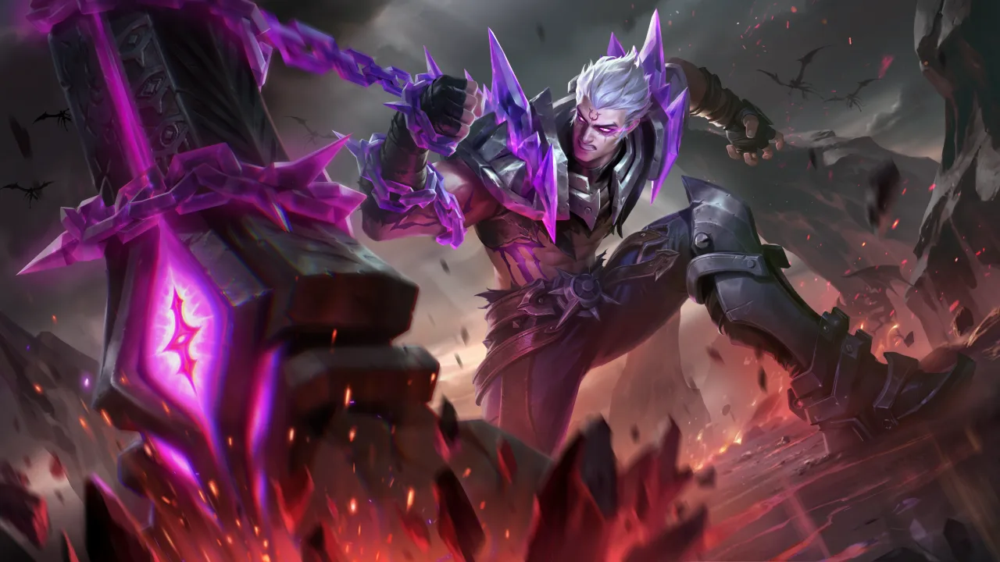
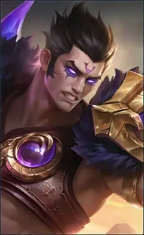

[Тир-лист](https://boostmlbb.ru/heroes/)[Предметы](https://boostmlbb.ru/items/)[Скины](https://boostmlbb.ru/skins/)[Новости и гайды](https://boostmlbb.ru/news/)

[Скины](https://boostmlbb.ru/skins/)/Фовиус

# Скины Фовиуса

Скинов

2

Можно купить

1

Последний

[Бунтарь матрицы](https://boostmlbb.ru/skins/phoveus/matrix-maverick.html)2025

[Профиль героя→](https://boostmlbb.ru/heroes/phoveus.html)

## Все скины

[Бунтарь матрицыИсключительный · 2025](https://boostmlbb.ru/skins/phoveus/matrix-maverick.html)[Страж монолитаОбычный · 2021](https://boostmlbb.ru/skins/phoveus/monolith-watcher.html)

**Поднимем ранг на герое Фовиус**Цена считается в калькуляторе

[Рассчитать цену](https://boostmlbb.ru/order.html?type=hero)

## Частые вопросы

Сколько скинов у Фовиуса?

2 скина без стандартного облика. Последний — «Бунтарь матрицы» (Matrix Maverick), 1 июля 2025.

Какие скины Фовиуса можно купить сейчас?

«Страж монолита» (269 алмазов). Остальные облики ограниченные и возвращаются только в событиях.

Какой самый редкий скин Фовиуса?

«Бунтарь матрицы» (Matrix Maverick), класс исключительный, серия «Звёздный участник». Награда «Звёздного участника» в июле 2025.
