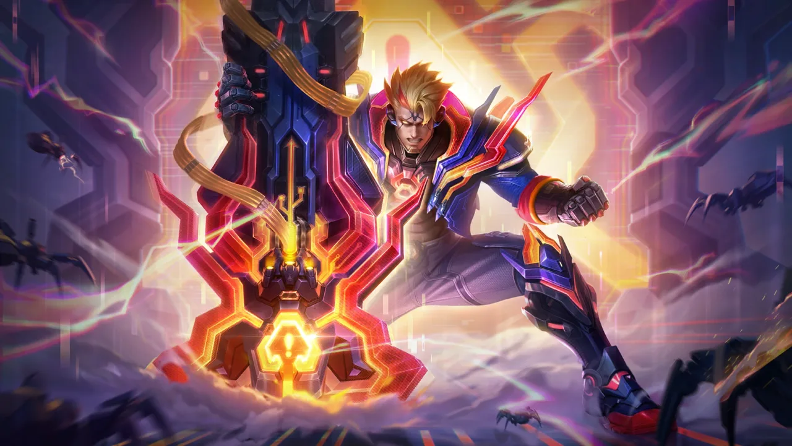

[Скины Фовиуса](https://boostmlbb.ru/skins/phoveus.html)

[Скины](https://boostmlbb.ru/skins/)/[Фовиус](https://boostmlbb.ru/skins/phoveus.html)/Бунтарь матрицы

[Скин Фовиуса](https://boostmlbb.ru/skins/phoveus.html)

# Бунтарь матрицы

Matrix Maverick

Исключительный ExceptionalЗвёздный участникОграниченный

Как получить

Награда «Звёздного участника» в июле 2025.

Вышел

1 июля 2025

## Что меняет облик

-   Новая внешность
-   Новые эффекты навыков
-   Анимация показа
-   Сцена показа
-   Бонус к характеристикам

## Все скины Фовиуса [2](https://boostmlbb.ru/skins/phoveus.html)

[Бунтарь матрицыИсключительный · 2025](https://boostmlbb.ru/skins/phoveus/matrix-maverick.html)[Страж монолитаОбычный · 2021](https://boostmlbb.ru/skins/phoveus/monolith-watcher.html)

## Серия «Звёздный участник»

[Морячка, рождённая приливомКалеа · 2026](https://boostmlbb.ru/skins/kalea/tideborn-sailor.html)[Тень кицунэХаябуса · 2026](https://boostmlbb.ru/skins/hayabusa/kitsune-s-shadow.html)[Клыки резниХанзо · 2026](https://boostmlbb.ru/skins/hanzo/fangs-of-slaughter.html)[Тлеющая крепостьБелерик · 2026](https://boostmlbb.ru/skins/belerick/smouldering-fortress.html)[Магитех­нический призракОбсидия · 2026](https://boostmlbb.ru/skins/obsidia/magitech-wraith.html)[Элизийское сияниеЦзэтянь · 2026](https://boostmlbb.ru/skins/zetian/elysian-luminance.html)[Батальон стражейХильда · 2026](https://boostmlbb.ru/skins/hilda/guardian-battalion.html)[Мечта­тельный коиХарли · 2026](https://boostmlbb.ru/skins/harley/dreaming-koi.html)

**Сколько стоит буст на герое Фовиус?**Выберите текущий и желаемый ранг. Стоимость появится на сайте.

[Рассчитать цену](https://boostmlbb.ru/order.html?type=hero)

## Частые вопросы

Как получить скин «Бунтарь матрицы» на Фовиуса?

Награда «Звёздного участника» в июле 2025.

Когда вышел скин «Бунтарь матрицы»?

1 июля 2025.

Какой класс у скина «Бунтарь матрицы»?

Исключительный (Exceptional), серия «Звёздный участник».
