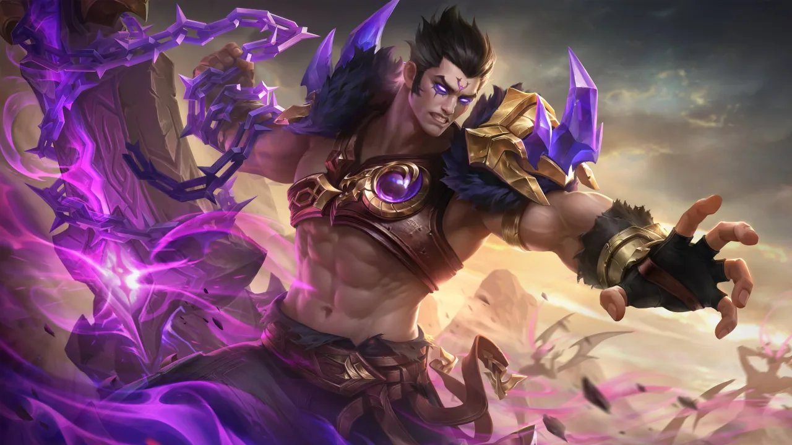

[Тир-лист](https://boostmlbb.ru/heroes/)[Предметы](https://boostmlbb.ru/items/)[Скины](https://boostmlbb.ru/skins/)[Новости и гайды](https://boostmlbb.ru/news/)

[Скины](https://boostmlbb.ru/skins/)/[Фовиус](https://boostmlbb.ru/skins/phoveus.html)/Страж монолита

[Скин Фовиуса](https://boostmlbb.ru/skins/phoveus.html)

# Страж монолита

Monolith Watcher

Обычный CommonВ продаже

Как получить

Продаётся в магазине обликов за 269 алмазов.

Цена

269 алмазов

Вышел

11 мая 2021

## Что меняет облик

-   Бонус к характеристикам

## Все скины Фовиуса [2](https://boostmlbb.ru/skins/phoveus.html)

[Бунтарь матрицыИсключительный · 2025](https://boostmlbb.ru/skins/phoveus/matrix-maverick.html)[Страж монолитаОбычный · 2021](https://boostmlbb.ru/skins/phoveus/monolith-watcher.html)

**Поднимем ранг на герое Фовиус**Цена считается в калькуляторе

[Рассчитать цену](https://boostmlbb.ru/order.html?type=hero)

## Частые вопросы

Как получить скин «Страж монолита» на Фовиуса?

Продаётся в магазине обликов за 269 алмазов.

Когда вышел скин «Страж монолита»?

11 мая 2021.

Какой класс у скина «Страж монолита»?

Обычный (Common).
