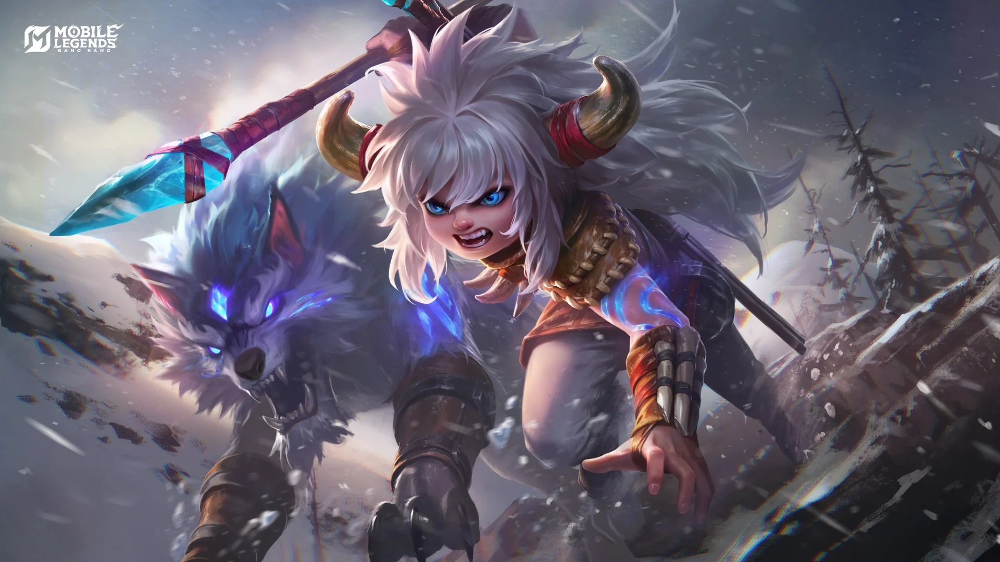

[Тир-лист](https://boostmlbb.ru/heroes/)[Предметы](https://boostmlbb.ru/items/)[Скины](https://boostmlbb.ru/skins/)[Новости и гайды](https://boostmlbb.ru/news/)

[Скины](https://boostmlbb.ru/skins/)/Пополь и Купа

# Скины Пополя и Купы

Скинов

6

Можно купить

2

Последний

[Протоо­хотник](https://boostmlbb.ru/skins/popol-and-kupa/proto-hunter.html)2025

[Профиль героя→](https://boostmlbb.ru/heroes/popol-and-kupa.html)

## Все скины

[Протоо­хотникИсключительный · 2025](https://boostmlbb.ru/skins/popol-and-kupa/proto-hunter.html)[Дух кистиИзысканный · 2023](https://boostmlbb.ru/skins/popol-and-kupa/spirit-of-the-brush.html)[Возму­тители спо­койствияИсключительный · 2022](https://boostmlbb.ru/skins/popol-and-kupa/trouble-makers.html)[Саундвейв и РэвиджГрандиозный · 2022](https://boostmlbb.ru/skins/popol-and-kupa/soundwave-ravage.html)[Вой племениОбычный · 2020](https://boostmlbb.ru/skins/popol-and-kupa/tribal-howl.html)[Друзья-охотникиОбычный · 2020](https://boostmlbb.ru/skins/popol-and-kupa/hunting-pals.html)

**Поднимем ранг на герое Пополь и Купа**Цена считается в калькуляторе

[Рассчитать цену](https://boostmlbb.ru/order.html?type=hero)

## Частые вопросы

Сколько скинов у Пополя и Купы?

6 скинов без стандартного облика. Последний — «Протоохотник» (Proto Hunter), 27 июня 2025.

Какие скины Пополя и Купы можно купить сейчас?

«Вой племени» (599 алмазов), «Друзья-охотники» (269 алмазов). Остальные облики ограниченные и возвращаются только в событиях.

Какой самый редкий скин Пополя и Купы?

«Саундвейв и Рэвидж» (Soundwave & Ravage), класс грандиозный, серия «Трансформеры». Выходил в событии коллаборации MLBB × Трансформеры. Ограниченные облики иногда возвращаются в розыгрышах событий.
