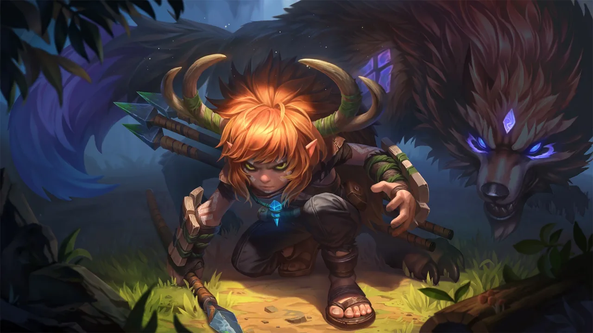

[Скины Пополя и Купы](https://boostmlbb.ru/skins/popol-and-kupa.html)

[Скины](https://boostmlbb.ru/skins/)/[Пополь и Купа](https://boostmlbb.ru/skins/popol-and-kupa.html)/Друзья-охотники

[Скин Пополя и Купы](https://boostmlbb.ru/skins/popol-and-kupa.html)

# Друзья-охотники

Hunting Pals

Обычный CommonВ продаже

Как получить

Продаётся в магазине обликов за 269 алмазов.

Цена

269 алмазов

Вышел

21 апреля 2020

## Что меняет облик

-   Бонус к характеристикам

## Все скины Пополя и Купы [6](https://boostmlbb.ru/skins/popol-and-kupa.html)

[Протоо­хотникИсключительный · 2025](https://boostmlbb.ru/skins/popol-and-kupa/proto-hunter.html)[Дух кистиИзысканный · 2023](https://boostmlbb.ru/skins/popol-and-kupa/spirit-of-the-brush.html)[Возму­тители спо­койствияИсключительный · 2022](https://boostmlbb.ru/skins/popol-and-kupa/trouble-makers.html)[Саундвейв и РэвиджГрандиозный · 2022](https://boostmlbb.ru/skins/popol-and-kupa/soundwave-ravage.html)[Вой племениОбычный · 2020](https://boostmlbb.ru/skins/popol-and-kupa/tribal-howl.html)[Друзья-охотникиОбычный · 2020](https://boostmlbb.ru/skins/popol-and-kupa/hunting-pals.html)

**Сколько стоит буст на герое Пополь и Купа?**Выберите текущий и желаемый ранг. Стоимость появится на сайте.

[Рассчитать цену](https://boostmlbb.ru/order.html?type=hero)

## Частые вопросы

Как получить скин «Друзья-охотники» на Пополя и Купу?

Продаётся в магазине обликов за 269 алмазов.

Когда вышел скин «Друзья-охотники»?

21 апреля 2020.

Какой класс у скина «Друзья-охотники»?

Обычный (Common).
