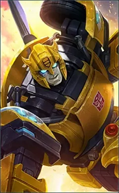

[Скины Пополя и Купы](https://boostmlbb.ru/skins/popol-and-kupa.html)

[Скины](https://boostmlbb.ru/skins/)/[Пополь и Купа](https://boostmlbb.ru/skins/popol-and-kupa.html)/Саундвейв и Рэвидж

[Скин Пополя и Купы](https://boostmlbb.ru/skins/popol-and-kupa.html)

# Саундвейв и Рэвидж

Soundwave & Ravage

Грандиозный GrandТрансформерыОграниченный

Как получить

Выходил в событии коллаборации MLBB × Трансформеры. Ограниченные облики иногда возвращаются в розыгрышах событий.

Вышел

24 мая 2022

## Что меняет облик

-   Новая внешность
-   Новые эффекты навыков
-   Звуки навыков
-   Своя озвучка
-   Анимация показа
-   Сцена показа
-   Музыка показа
-   Особые действия
-   Бонус к характеристикам

## Все скины Пополя и Купы [6](https://boostmlbb.ru/skins/popol-and-kupa.html)

[Протоо­хотникИсключительный · 2025](https://boostmlbb.ru/skins/popol-and-kupa/proto-hunter.html)[Дух кистиИзысканный · 2023](https://boostmlbb.ru/skins/popol-and-kupa/spirit-of-the-brush.html)[Возму­тители спо­койствияИсключительный · 2022](https://boostmlbb.ru/skins/popol-and-kupa/trouble-makers.html)[Саундвейв и РэвиджГрандиозный · 2022](https://boostmlbb.ru/skins/popol-and-kupa/soundwave-ravage.html)[Вой племениОбычный · 2020](https://boostmlbb.ru/skins/popol-and-kupa/tribal-howl.html)[Друзья-охотникиОбычный · 2020](https://boostmlbb.ru/skins/popol-and-kupa/hunting-pals.html)

## Серия «Трансформеры»

[БамблбиИкс.Борг · 2025](https://boostmlbb.ru/skins/x-borg/bumblebee.html)[Оптимус ПраймДжонсон · 2023](https://boostmlbb.ru/skins/johnson/optimus-prime.html)[МегатронГрейнджер · 2023](https://boostmlbb.ru/skins/granger/megatron.html)[СтарскримАлдос · 2022](https://boostmlbb.ru/skins/aldous/starscream.html)[ГримлокРоджер · 2022](https://boostmlbb.ru/skins/roger/grimlock.html)

**Сколько стоит буст на герое Пополь и Купа?**Выберите текущий и желаемый ранг. Стоимость появится на сайте.

[Рассчитать цену](https://boostmlbb.ru/order.html?type=hero)

## Частые вопросы

Как получить скин «Саундвейв и Рэвидж» на Пополя и Купу?

Выходил в событии коллаборации MLBB × Трансформеры. Ограниченные облики иногда возвращаются в розыгрышах событий.

Когда вышел скин «Саундвейв и Рэвидж»?

24 мая 2022.

Какой класс у скина «Саундвейв и Рэвидж»?

Грандиозный (Grand), серия «Трансформеры».
