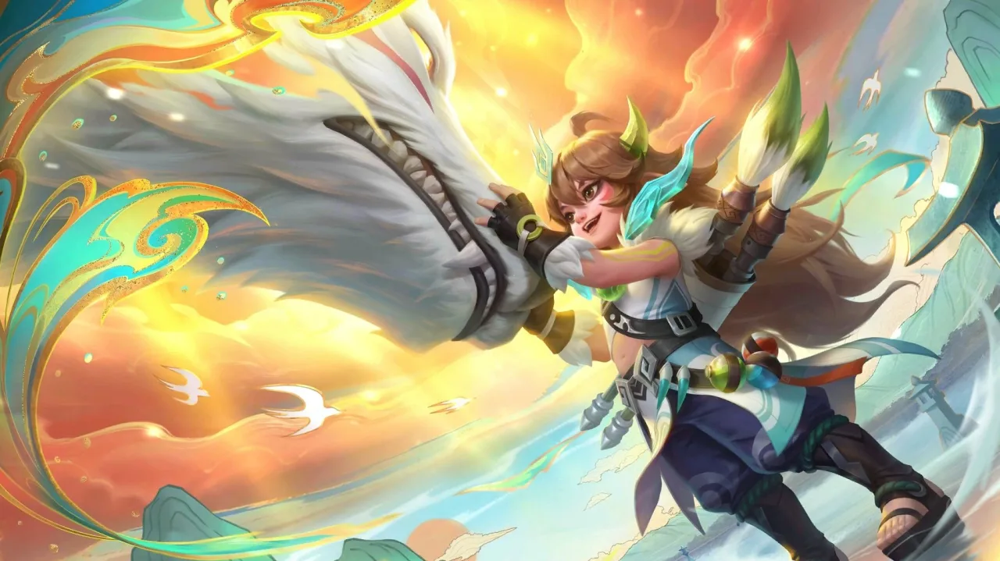
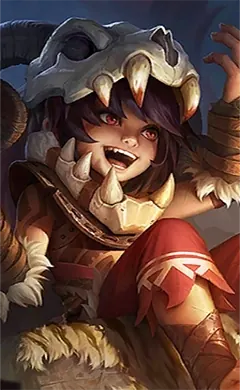

[Тир-лист](https://boostmlbb.ru/heroes/)[Предметы](https://boostmlbb.ru/items/)[Скины](https://boostmlbb.ru/skins/)[Новости и гайды](https://boostmlbb.ru/news/)

[Скины](https://boostmlbb.ru/skins/)/[Пополь и Купа](https://boostmlbb.ru/skins/popol-and-kupa.html)/Дух кисти

[Скин Пополя и Купы](https://boostmlbb.ru/skins/popol-and-kupa.html)

# Дух кисти

Spirit of the Brush

Изысканный ExquisiteКоллекционныйОграниченный

Как получить

Главный приз розыгрыша в коллекционном событии, попытки покупаются за алмазы. Ограниченные облики иногда возвращаются в розыгрышах событий.

Вышел

10 ноября 2023

## Что меняет облик

-   Новая внешность
-   Новые эффекты навыков
-   Звуки навыков
-   Своя озвучка
-   Анимация показа
-   Сцена показа
-   Музыка показа
-   Особые действия
-   Бонус к характеристикам

## Все скины Пополя и Купы [6](https://boostmlbb.ru/skins/popol-and-kupa.html)

[Протоо­хотникИсключительный · 2025](https://boostmlbb.ru/skins/popol-and-kupa/proto-hunter.html)[Дух кистиИзысканный · 2023](https://boostmlbb.ru/skins/popol-and-kupa/spirit-of-the-brush.html)[Возму­тители спо­койствияИсключительный · 2022](https://boostmlbb.ru/skins/popol-and-kupa/trouble-makers.html)[Саундвейв и РэвиджГрандиозный · 2022](https://boostmlbb.ru/skins/popol-and-kupa/soundwave-ravage.html)[Вой племениОбычный · 2020](https://boostmlbb.ru/skins/popol-and-kupa/tribal-howl.html)[Друзья-охотникиОбычный · 2020](https://boostmlbb.ru/skins/popol-and-kupa/hunting-pals.html)

## Серия «Коллекционный»

[ОчистительБруно · 2026](https://boostmlbb.ru/skins/bruno/the-purifier.html)[Небесный бунтарьСан · 2026](https://boostmlbb.ru/skins/sun/celestial-rebel.html)[Кайдзю глубинХелкарт · 2026](https://boostmlbb.ru/skins/helcurt/kaiju-of-the-deep.html)[Звёздный дозорныйКимми · 2026](https://boostmlbb.ru/skins/kimmy/starbound-sentry.html)[Монархиня грёзАлиса · 2026](https://boostmlbb.ru/skins/alice/dreaming-monarch.html)[Дрожь глубинГрок · 2026](https://boostmlbb.ru/skins/grock/tremor-of-the-deep.html)[Небесный генералТигрил · 2026](https://boostmlbb.ru/skins/tigreal/celestial-general.html)[Монарх, рождённый солнцемКсавьер · 2026](https://boostmlbb.ru/skins/xavier/sunborn-monarch.html)

**Поднимем ранг на герое Пополь и Купа**Цена считается в калькуляторе

[Рассчитать цену](https://boostmlbb.ru/order.html?type=hero)

## Частые вопросы

Как получить скин «Дух кисти» на Пополя и Купу?

Главный приз розыгрыша в коллекционном событии, попытки покупаются за алмазы. Ограниченные облики иногда возвращаются в розыгрышах событий.

Когда вышел скин «Дух кисти»?

10 ноября 2023.

Какой класс у скина «Дух кисти»?

Изысканный (Exquisite), серия «Коллекционный».
