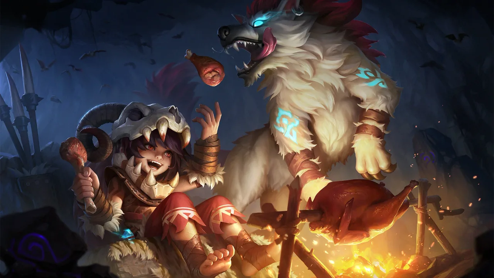

[Скины Пополя и Купы](https://boostmlbb.ru/skins/popol-and-kupa.html)

[Скины](https://boostmlbb.ru/skins/)/[Пополь и Купа](https://boostmlbb.ru/skins/popol-and-kupa.html)/Вой племени

[Скин Пополя и Купы](https://boostmlbb.ru/skins/popol-and-kupa.html)

# Вой племени

Tribal Howl

Обычный CommonЭлитныйВ продаже

Как получить

Продаётся в магазине обликов за 599 алмазов.

Цена

599 алмазов

Вышел

28 сентября 2020

## Что меняет облик

-   Новая внешность
-   Другой цвет эффектов
-   Анимация показа
-   Бонус к характеристикам

## Все скины Пополя и Купы [6](https://boostmlbb.ru/skins/popol-and-kupa.html)

[Протоо­хотникИсключительный · 2025](https://boostmlbb.ru/skins/popol-and-kupa/proto-hunter.html)[Дух кистиИзысканный · 2023](https://boostmlbb.ru/skins/popol-and-kupa/spirit-of-the-brush.html)[Возму­тители спо­койствияИсключительный · 2022](https://boostmlbb.ru/skins/popol-and-kupa/trouble-makers.html)[Саундвейв и РэвиджГрандиозный · 2022](https://boostmlbb.ru/skins/popol-and-kupa/soundwave-ravage.html)[Вой племениОбычный · 2020](https://boostmlbb.ru/skins/popol-and-kupa/tribal-howl.html)[Друзья-охотникиОбычный · 2020](https://boostmlbb.ru/skins/popol-and-kupa/hunting-pals.html)

## Серия «Элитный»

[Золотой османтусЧан'Э · 2026](https://boostmlbb.ru/skins/change/golden-osmanthus.html)[Король-воена­чальникМартис · 2025](https://boostmlbb.ru/skins/martis/warlord-king.html)[Кадет открытого моряКимми · 2024](https://boostmlbb.ru/skins/kimmy/high-seas-cadet.html)[Зелёная копейщицаСильвана · 2024](https://boostmlbb.ru/skins/silvanna/verdant-lancer.html)[Мародёр Кровавое КопытоХилос · 2024](https://boostmlbb.ru/skins/hylos/bloodhoof-marauder.html)[Изящная бабочкаГвиневра · 2024](https://boostmlbb.ru/skins/guinevere/elegant-butterfly.html)[Маркиз клинковЛанселот · 2024](https://boostmlbb.ru/skins/lancelot/marques-of-blades.html)[Привал в пустошахЧип · 2024](https://boostmlbb.ru/skins/chip/badlands-hiatus.html)

**Сколько стоит буст на герое Пополь и Купа?**Выберите текущий и желаемый ранг. Стоимость появится на сайте.

[Рассчитать цену](https://boostmlbb.ru/order.html?type=hero)

## Частые вопросы

Как получить скин «Вой племени» на Пополя и Купу?

Продаётся в магазине обликов за 599 алмазов.

Когда вышел скин «Вой племени»?

28 сентября 2020.

Какой класс у скина «Вой племени»?

Обычный (Common), серия «Элитный».
