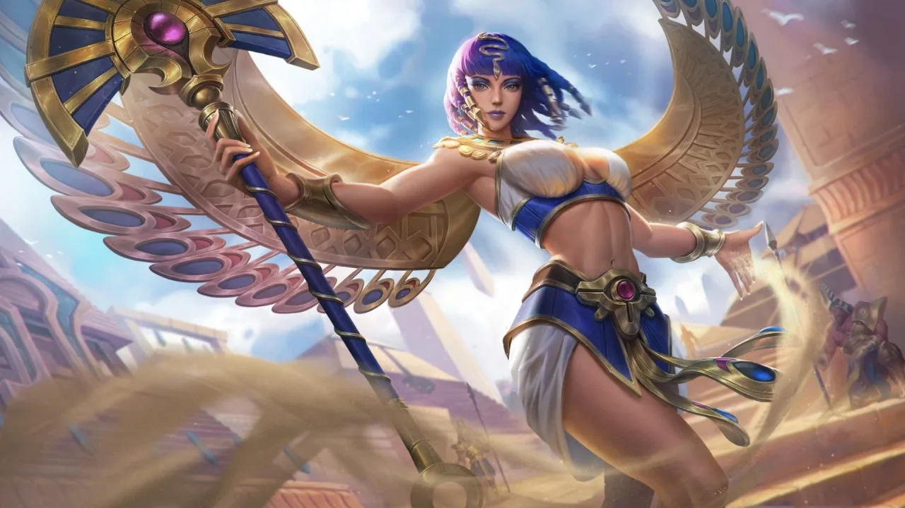

[Скины Рафаэль](https://boostmlbb.ru/skins/rafaela.html)

[Скины](https://boostmlbb.ru/skins/)/[Рафаэль](https://boostmlbb.ru/skins/rafaela.html)/Богиня плодородия

[Скин Рафаэль](https://boostmlbb.ru/skins/rafaela.html)

# Богиня плодородия

Fertility Goddess

Обычный CommonЭлитныйВ продаже

Как получить

Продаётся в магазине обликов за 399 алмазов.

Цена

399 алмазов

Вышел

2016 год

## Что меняет облик

-   Бонус к характеристикам

## Все скины Рафаэль [8](https://boostmlbb.ru/skins/rafaela.html)

[Цветение изобилияДелюкс · 2025](https://boostmlbb.ru/skins/rafaela/bloom-of-abundance.html)[Серафи­ческое селфиИсключительный · 2023](https://boostmlbb.ru/skins/rafaela/seraphic-selfie.html)[Ангельская сонатаИсключительный · 2022](https://boostmlbb.ru/skins/rafaela/angelic-sonata.html)[Охотница за звёздамиОбычный · 2020](https://boostmlbb.ru/skins/rafaela/star-chaser.html)[БиомедикИсключительный · 2018](https://boostmlbb.ru/skins/rafaela/biomedic.html)[Спаси­тельница S.A.B.E.R.Делюкс · 2017](https://boostmlbb.ru/skins/rafaela/s-a-b-e-r-savior.html)[Цветочная феяДелюкс · 2017](https://boostmlbb.ru/skins/rafaela/flower-fairy.html)[Богиня плодородияОбычный · 2016](https://boostmlbb.ru/skins/rafaela/fertility-goddess.html)

## Серия «Элитный»

[Золотой османтусЧан'Э · 2026](https://boostmlbb.ru/skins/change/golden-osmanthus.html)[Король-воена­чальникМартис · 2025](https://boostmlbb.ru/skins/martis/warlord-king.html)[Кадет открытого моряКимми · 2024](https://boostmlbb.ru/skins/kimmy/high-seas-cadet.html)[Зелёная копейщицаСильвана · 2024](https://boostmlbb.ru/skins/silvanna/verdant-lancer.html)[Мародёр Кровавое КопытоХилос · 2024](https://boostmlbb.ru/skins/hylos/bloodhoof-marauder.html)[Изящная бабочкаГвиневра · 2024](https://boostmlbb.ru/skins/guinevere/elegant-butterfly.html)[Маркиз клинковЛанселот · 2024](https://boostmlbb.ru/skins/lancelot/marques-of-blades.html)[Привал в пустошахЧип · 2024](https://boostmlbb.ru/skins/chip/badlands-hiatus.html)

**Сколько стоит буст на герое Рафаэль?**Выберите текущий и желаемый ранг. Стоимость появится на сайте.

[Рассчитать цену](https://boostmlbb.ru/order.html?type=hero)

## Частые вопросы

Как получить скин «Богиня плодородия» на Рафаэль?

Продаётся в магазине обликов за 399 алмазов.

Когда вышел скин «Богиня плодородия»?

2016 год.

Какой класс у скина «Богиня плодородия»?

Обычный (Common), серия «Элитный».
