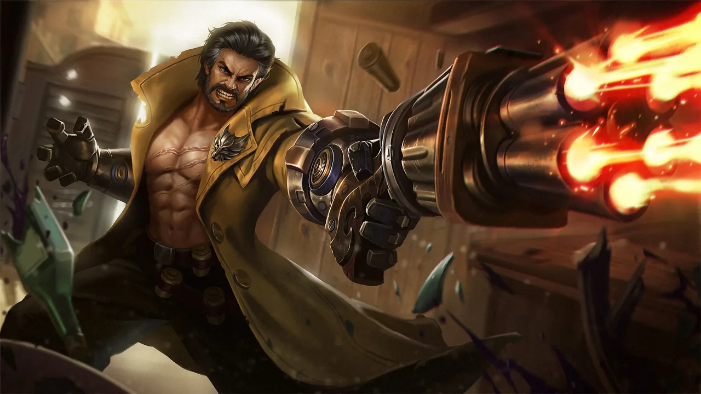

[Все скины](https://boostmlbb.ru/skins/)

[Скины](https://boostmlbb.ru/skins/)/Роджер

# Скины Роджера

Скинов

8

Можно купить

2

Последний

[Гримлок](https://boostmlbb.ru/skins/roger/grimlock.html)2022

[Профиль героя→](https://boostmlbb.ru/heroes/roger.html)

## Все скины

ВсеГрандиозныйИзысканныйДелюксИсключительныйОбычный

[ГримлокГрандиозный · 2022](https://boostmlbb.ru/skins/roger/grimlock.html)[Призрачный рейнджерДелюкс · 2021](https://boostmlbb.ru/skins/roger/phantom-ranger.html)[Охотник на нечистьГрандиозный · 2021](https://boostmlbb.ru/skins/roger/fiend-hunter.html)[Киборг-оборотеньДелюкс · 2021](https://boostmlbb.ru/skins/roger/cyborg-werewolf.html)[Призрачный охотникДелюкс · 2018](https://boostmlbb.ru/skins/roger/phantom-hunter.html)[АнубисИсключительный · 2018](https://boostmlbb.ru/skins/roger/anubis.html)[Доктор ЗверьИзысканный · 2017](https://boostmlbb.ru/skins/roger/dr-beast.html)[Тёмный джентльменОбычный · 2017](https://boostmlbb.ru/skins/roger/dark-gent.html)

**Сколько стоит буст на герое Роджер?**Выберите текущий и желаемый ранг. Стоимость появится на сайте.

[Рассчитать цену](https://boostmlbb.ru/order.html?type=hero)

## Частые вопросы

Сколько скинов у Роджера?

8 скинов без стандартного облика. Последний — «Гримлок» (Grimlock), 24 мая 2022.

Какие скины Роджера можно купить сейчас?

«Призрачный охотник» (899 алмазов), «Тёмный джентльмен» (269 алмазов). Остальные облики ограниченные и возвращаются только в событиях.

Какой самый редкий скин Роджера?

«Гримлок» (Grimlock), класс грандиозный, серия «Трансформеры». Выходил в событии коллаборации MLBB × Трансформеры. Ограниченные облики иногда возвращаются в розыгрышах событий.
