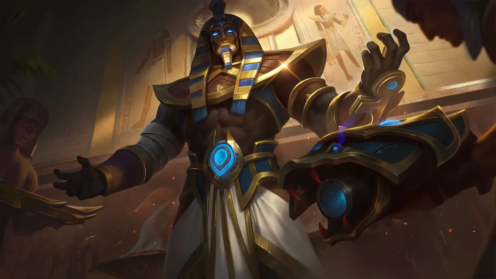

[Скины Роджера](https://boostmlbb.ru/skins/roger.html)

[Скины](https://boostmlbb.ru/skins/)/[Роджер](https://boostmlbb.ru/skins/roger.html)/Анубис

[Скин Роджера](https://boostmlbb.ru/skins/roger.html)

# Анубис

Anubis

Исключительный ExceptionalЗвёздный участникОграниченный

Как получить

Награда «Звёздного участника» в феврале 2018.

Вышел

1 февраля 2018

## Что меняет облик

-   Новая внешность
-   Новые эффекты навыков
-   Анимация показа
-   Бонус к характеристикам

## Все скины Роджера [8](https://boostmlbb.ru/skins/roger.html)

[ГримлокГрандиозный · 2022](https://boostmlbb.ru/skins/roger/grimlock.html)[Призрачный рейнджерДелюкс · 2021](https://boostmlbb.ru/skins/roger/phantom-ranger.html)[Охотник на нечистьГрандиозный · 2021](https://boostmlbb.ru/skins/roger/fiend-hunter.html)[Киборг-оборотеньДелюкс · 2021](https://boostmlbb.ru/skins/roger/cyborg-werewolf.html)[Призрачный охотникДелюкс · 2018](https://boostmlbb.ru/skins/roger/phantom-hunter.html)[АнубисИсключительный · 2018](https://boostmlbb.ru/skins/roger/anubis.html)[Доктор ЗверьИзысканный · 2017](https://boostmlbb.ru/skins/roger/dr-beast.html)[Тёмный джентльменОбычный · 2017](https://boostmlbb.ru/skins/roger/dark-gent.html)

## Серия «Звёздный участник»

[Морячка, рождённая приливомКалеа · 2026](https://boostmlbb.ru/skins/kalea/tideborn-sailor.html)[Тень кицунэХаябуса · 2026](https://boostmlbb.ru/skins/hayabusa/kitsune-s-shadow.html)[Клыки резниХанзо · 2026](https://boostmlbb.ru/skins/hanzo/fangs-of-slaughter.html)[Тлеющая крепостьБелерик · 2026](https://boostmlbb.ru/skins/belerick/smouldering-fortress.html)[Магитех­нический призракОбсидия · 2026](https://boostmlbb.ru/skins/obsidia/magitech-wraith.html)[Элизийское сияниеЦзэтянь · 2026](https://boostmlbb.ru/skins/zetian/elysian-luminance.html)[Батальон стражейХильда · 2026](https://boostmlbb.ru/skins/hilda/guardian-battalion.html)[Мечта­тельный коиХарли · 2026](https://boostmlbb.ru/skins/harley/dreaming-koi.html)

**Сколько стоит буст на герое Роджер?**Выберите текущий и желаемый ранг. Стоимость появится на сайте.

[Рассчитать цену](https://boostmlbb.ru/order.html?type=hero)

## Частые вопросы

Как получить скин «Анубис» на Роджера?

Награда «Звёздного участника» в феврале 2018.

Когда вышел скин «Анубис»?

1 февраля 2018.

Какой класс у скина «Анубис»?

Исключительный (Exceptional), серия «Звёздный участник».
