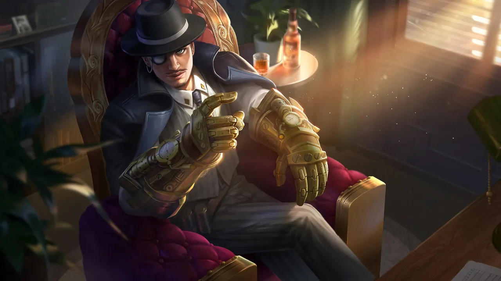
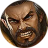

[Тир-лист](https://boostmlbb.ru/heroes/)[Предметы](https://boostmlbb.ru/items/)[Скины](https://boostmlbb.ru/skins/)[Новости и гайды](https://boostmlbb.ru/news/)

[Скины](https://boostmlbb.ru/skins/)/[Роджер](https://boostmlbb.ru/skins/roger.html)/Тёмный джентльмен

[Скин Роджера](https://boostmlbb.ru/skins/roger.html)

# Тёмный джентльмен

Dark Gent

Обычный CommonВ продаже

Как получить

Продаётся в магазине обликов за 269 алмазов.

Цена

269 алмазов

Вышел

11 августа 2017

## Что меняет облик

-   Бонус к характеристикам

## Все скины Роджера [8](https://boostmlbb.ru/skins/roger.html)

[ГримлокГрандиозный · 2022](https://boostmlbb.ru/skins/roger/grimlock.html)[Призрачный рейнджерДелюкс · 2021](https://boostmlbb.ru/skins/roger/phantom-ranger.html)[Охотник на нечистьГрандиозный · 2021](https://boostmlbb.ru/skins/roger/fiend-hunter.html)[Киборг-оборотеньДелюкс · 2021](https://boostmlbb.ru/skins/roger/cyborg-werewolf.html)[Призрачный охотникДелюкс · 2018](https://boostmlbb.ru/skins/roger/phantom-hunter.html)[АнубисИсключительный · 2018](https://boostmlbb.ru/skins/roger/anubis.html)[Доктор ЗверьИзысканный · 2017](https://boostmlbb.ru/skins/roger/dr-beast.html)[Тёмный джентльменОбычный · 2017](https://boostmlbb.ru/skins/roger/dark-gent.html)

**Поднимем ранг на герое Роджер**Цена считается в калькуляторе

[Рассчитать цену](https://boostmlbb.ru/order.html?type=hero)

## Частые вопросы

Как получить скин «Тёмный джентльмен» на Роджера?

Продаётся в магазине обликов за 269 алмазов.

Когда вышел скин «Тёмный джентльмен»?

11 августа 2017.

Какой класс у скина «Тёмный джентльмен»?

Обычный (Common).
