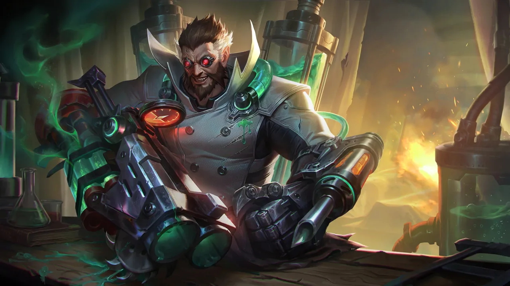

[Скины Роджера](https://boostmlbb.ru/skins/roger.html)

[Скины](https://boostmlbb.ru/skins/)/[Роджер](https://boostmlbb.ru/skins/roger.html)/Доктор Зверь

[Скин Роджера](https://boostmlbb.ru/skins/roger.html)

# Доктор Зверь

Dr. Beast

Изысканный ExquisiteЯщик удачиОграниченный

Как получить

Выпадал из ящиков удачи в событиях. Ограниченные облики иногда возвращаются в розыгрышах событий.

Вышел

2 октября 2017

## Что меняет облик

-   Новая внешность
-   Новые эффекты навыков
-   Анимация показа
-   Сцена показа
-   Бонус к характеристикам

## Все скины Роджера [8](https://boostmlbb.ru/skins/roger.html)

[ГримлокГрандиозный · 2022](https://boostmlbb.ru/skins/roger/grimlock.html)[Призрачный рейнджерДелюкс · 2021](https://boostmlbb.ru/skins/roger/phantom-ranger.html)[Охотник на нечистьГрандиозный · 2021](https://boostmlbb.ru/skins/roger/fiend-hunter.html)[Киборг-оборотеньДелюкс · 2021](https://boostmlbb.ru/skins/roger/cyborg-werewolf.html)[Призрачный охотникДелюкс · 2018](https://boostmlbb.ru/skins/roger/phantom-hunter.html)[АнубисИсключительный · 2018](https://boostmlbb.ru/skins/roger/anubis.html)[Доктор ЗверьИзысканный · 2017](https://boostmlbb.ru/skins/roger/dr-beast.html)[Тёмный джентльменОбычный · 2017](https://boostmlbb.ru/skins/roger/dark-gent.html)

## Серия «Ящик удачи»

[Леди-журавльГвиневра · 2025](https://boostmlbb.ru/skins/guinevere/lady-crane.html)[Серафим-бабочкаЛюнокс · 2025](https://boostmlbb.ru/skins/lunox/butterfly-seraphim.html)[МехадраконКлауд · 2025](https://boostmlbb.ru/skins/claude/mecha-dragon.html)[Лунная магияЧан'Э · 2020](https://boostmlbb.ru/skins/change/lunar-magic.html)[Громовая вспышкаСелена · 2020](https://boostmlbb.ru/skins/selena/thunder-flash.html)[РакшасаХанаби · 2020](https://boostmlbb.ru/skins/hanabi/rakshesha.html)[Повелитель видеоигрУранус · 2020](https://boostmlbb.ru/skins/uranus/video-game-dominator.html)[Бог войныМартис · 2020](https://boostmlbb.ru/skins/martis/god-of-war.html)

**Сколько стоит буст на герое Роджер?**Выберите текущий и желаемый ранг. Стоимость появится на сайте.

[Рассчитать цену](https://boostmlbb.ru/order.html?type=hero)

## Частые вопросы

Как получить скин «Доктор Зверь» на Роджера?

Выпадал из ящиков удачи в событиях. Ограниченные облики иногда возвращаются в розыгрышах событий.

Когда вышел скин «Доктор Зверь»?

2 октября 2017.

Какой класс у скина «Доктор Зверь»?

Изысканный (Exquisite), серия «Ящик удачи».
