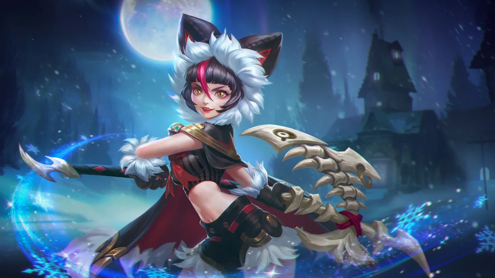

[Скины Руби](https://boostmlbb.ru/skins/ruby.html)

[Скины](https://boostmlbb.ru/skins/)/[Руби](https://boostmlbb.ru/skins/ruby.html)/Кошечка

[Скин Руби](https://boostmlbb.ru/skins/ruby.html)

# Кошечка

Cat Girl

Обычный CommonВ продаже

Как получить

Продаётся в магазине обликов за 269 алмазов.

Цена

269 алмазов

Вышел

11 августа 2017

## Что меняет облик

-   Бонус к характеристикам

## Все скины Руби [10](https://boostmlbb.ru/skins/ruby.html)

[Неоновый клинокИсключительный · 2025](https://boostmlbb.ru/skins/ruby/neon-edge.html)[Дервиш полумесяцаИсключительный · 2025](https://boostmlbb.ru/skins/ruby/crescent-dervish.html)[Жнец душИсключительный · 2024](https://boostmlbb.ru/skins/ruby/soul-reaper.html)[Меха-деваГрандиозный · 2023](https://boostmlbb.ru/skins/ruby/mecha-maiden.html)[Призмати­ческое пероИзысканный · 2023](https://boostmlbb.ru/skins/ruby/prismatic-plume.html)[Пиратский попугайИсключительный · 2021](https://boostmlbb.ru/skins/ruby/pirate-parrot.html)[Леди-зомбиИзысканный · 2019](https://boostmlbb.ru/skins/ruby/lady-zombie.html)[ЭдельвейсОбычный · 2018](https://boostmlbb.ru/skins/ruby/edelweiss.html)[КошечкаОбычный · 2017](https://boostmlbb.ru/skins/ruby/cat-girl.html)[Бабочка тайной орхидеиОбычный · 2017](https://boostmlbb.ru/skins/ruby/hidden-orchid-butterfly.html)

**Сколько стоит буст на герое Руби?**Выберите текущий и желаемый ранг. Стоимость появится на сайте.

[Рассчитать цену](https://boostmlbb.ru/order.html?type=hero)

## Частые вопросы

Как получить скин «Кошечка» на Руби?

Продаётся в магазине обликов за 269 алмазов.

Когда вышел скин «Кошечка»?

11 августа 2017.

Какой класс у скина «Кошечка»?

Обычный (Common).
