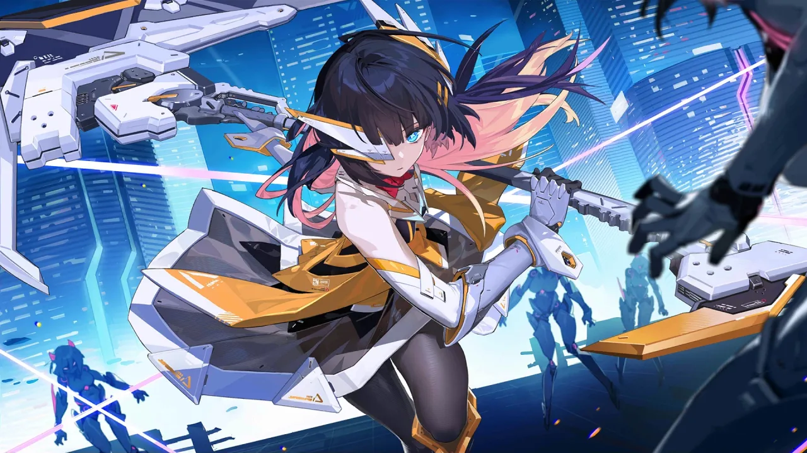

[Скины Руби](https://boostmlbb.ru/skins/ruby.html)

[Скины](https://boostmlbb.ru/skins/)/[Руби](https://boostmlbb.ru/skins/ruby.html)/Меха-дева

[Скин Руби](https://boostmlbb.ru/skins/ruby.html)

# Меха-дева

Mecha Maiden

Грандиозный GrandПретендентыОграниченный

Как получить

Выходил в событии «Претенденты». Ограниченные облики иногда возвращаются в розыгрышах событий.

Вышел

7 октября 2023

## Что меняет облик

-   Новая внешность
-   Новые эффекты навыков
-   Звуки навыков
-   Своя озвучка
-   Иконки навыков
-   Анимация показа
-   Сцена показа
-   Музыка показа
-   Анимация появления
-   Особые действия
-   Бонус к характеристикам

## Все скины Руби [10](https://boostmlbb.ru/skins/ruby.html)

[Неоновый клинокИсключительный · 2025](https://boostmlbb.ru/skins/ruby/neon-edge.html)[Дервиш полумесяцаИсключительный · 2025](https://boostmlbb.ru/skins/ruby/crescent-dervish.html)[Жнец душИсключительный · 2024](https://boostmlbb.ru/skins/ruby/soul-reaper.html)[Меха-деваГрандиозный · 2023](https://boostmlbb.ru/skins/ruby/mecha-maiden.html)[Призмати­ческое пероИзысканный · 2023](https://boostmlbb.ru/skins/ruby/prismatic-plume.html)[Пиратский попугайИсключительный · 2021](https://boostmlbb.ru/skins/ruby/pirate-parrot.html)[Леди-зомбиИзысканный · 2019](https://boostmlbb.ru/skins/ruby/lady-zombie.html)[ЭдельвейсОбычный · 2018](https://boostmlbb.ru/skins/ruby/edelweiss.html)[КошечкаОбычный · 2017](https://boostmlbb.ru/skins/ruby/cat-girl.html)[Бабочка тайной орхидеиОбычный · 2017](https://boostmlbb.ru/skins/ruby/hidden-orchid-butterfly.html)

## Серия «Претенденты»

[Райко Серебряная МолнияСелена · 2026](https://boostmlbb.ru/skins/selena/silverbolt-raiko.html)[Импе­ратрица АрасиОбсидия · 2026](https://boostmlbb.ru/skins/obsidia/imperatrix-arashi.html)[Сияние рассветаГвиневра · 2025](https://boostmlbb.ru/skins/guinevere/daybreak-halo.html)[Сумеречная звездаВексана · 2025](https://boostmlbb.ru/skins/vexana/twilight-star.html)[Техни­ческий генийЧан'Э · 2024](https://boostmlbb.ru/skins/change/tech-tensai.html)[Меткий призракЛесли · 2024](https://boostmlbb.ru/skins/lesley/deadeye-spectre.html)[Клинок надеждыФанни · 2022](https://boostmlbb.ru/skins/fanny/blade-of-kibou.html)[Мисс ХикариЛейла · 2022](https://boostmlbb.ru/skins/layla/miss-hikari.html)

**Сколько стоит буст на герое Руби?**Выберите текущий и желаемый ранг. Стоимость появится на сайте.

[Рассчитать цену](https://boostmlbb.ru/order.html?type=hero)

## Частые вопросы

Как получить скин «Меха-дева» на Руби?

Выходил в событии «Претенденты». Ограниченные облики иногда возвращаются в розыгрышах событий.

Когда вышел скин «Меха-дева»?

7 октября 2023.

Какой класс у скина «Меха-дева»?

Грандиозный (Grand), серия «Претенденты».
